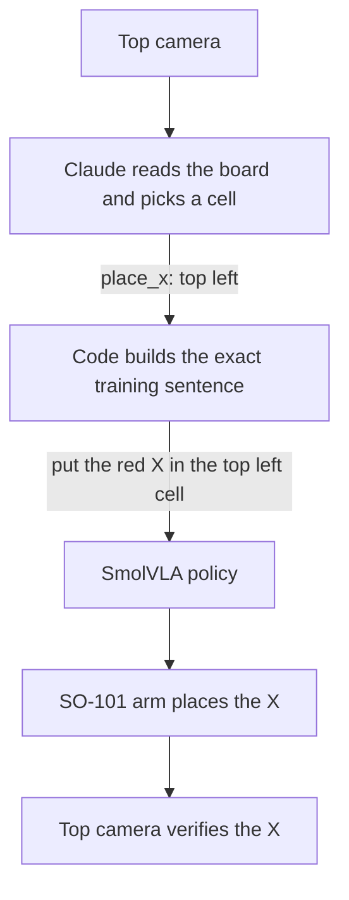
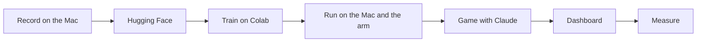

<p align="center"></p>

# SO-101 XOX

**English** · [Türkçe](README.tr.md)

An SO-101 robot arm plays tic-tac-toe ("XOX" in Turkish) as X against a person who plays O. Claude reads the board from a camera above the table and picks a cell, code turns that pick into the exact sentence the policy was trained on, and a SmolVLA policy fine-tuned on 45 teleoperated demonstrations moves the arm. So far: ten completed moves on the real arm, all ten in the right cell, six of the nine cells tried. That is a pilot, not a success rate.


*The third move of a game, seen by the top camera: Claude picked `middle left`, and the arm is putting the X there.*

## One turn



## How it was built



## Links

| | |
|---|---|
| Guided write-up | <https://so101-xox.getporti.com> |
| Blog post | <https://getporti.com/paper/so101-tic-tac-toe> |
| Detailed write-up | [`docs/writeup.md`](docs/writeup.md) |
| Measurements | [`docs/benchmarks.md`](docs/benchmarks.md) |
| Clean dataset | [`fport/tic-tac-toe-so101-x-round1-clean-v1`](https://huggingface.co/datasets/fport/tic-tac-toe-so101-x-round1-clean-v1) |
| Raw dataset | [`fport/tic-tac-toe-so101-x-round1`](https://huggingface.co/datasets/fport/tic-tac-toe-so101-x-round1) |
| Model | [`fport/smolvla-tic-tac-toe-so101-x-round1-20k`](https://huggingface.co/fport/smolvla-tic-tac-toe-so101-x-round1-20k) |


*From the measurements: the arm moved in jerks until the inference setting was changed to `sync`. All six charts are in [`docs/benchmarks.md`](docs/benchmarks.md).*

## Quick start

```bash
uv sync                                              # .venv: LeRobot, for recording, training and the policy
uv venv .venv-strands --python 3.12 && source .venv-strands/bin/activate
uv pip install "strands-robots[lerobot,smolvla]" "strands-agents[anthropic]"
python scripts/strands_game.py play                  # Claude is X, you are O; opens the dashboard
python scripts/strands_game.py eval --trials 10      # per-cell benchmark on the arm, no Claude
python -m xox.dashboard --demo                       # the dashboard alone, with a scripted game
```

`play` needs `ANTHROPIC_API_KEY` in a `.env` file at the repo root, and both `play` and `eval` need the arm and the two cameras. The dashboard and `eval` have so far been tested with a fake arm only. Flags, stopping the arm and everything else: [`docs/strands.md`](docs/strands.md).

## Repository layout

```
xox/            the game package (python -m xox)
  board.py      cell names, the task sentence, the winner
  vision.py     what the top camera tells the game
  arm.py        the robot, the policy, the per-move log
  game.py       the play loop with Claude
  evaluate.py   the eval command
  cli.py        the commands and their flags
  i18n.py       terminal messages in English and Turkish
  state.py      the game state shared with the dashboard
  dashboard/    the local web page
scripts/        game wrapper, recording plan, logged rollout, frame capture
notebooks/      the Colab training notebook
benchmarks/     scripts and tables behind the charts
docs/           the documents below, Turkish under docs/tr/
calibration/    calibration files of the two arms
assets/         the cover image
```

## Docs

| | |
|---|---|
| Write-up | [`docs/writeup.md`](docs/writeup.md) |
| Measurements | [`docs/benchmarks.md`](docs/benchmarks.md) |
| Recording | [`docs/recording.md`](docs/recording.md) |
| Training notebook | [`notebooks/train_smolvla_round1.ipynb`](notebooks/train_smolvla_round1.ipynb) |
| The game, Strands and `eval` | [`docs/strands.md`](docs/strands.md) |
| Operations | [`docs/operations.md`](docs/operations.md) |
| Method | [`docs/method.md`](docs/method.md) |
| Lab log | [`docs/plan.md`](docs/plan.md) |

## Licence

Apache License 2.0, see [`LICENSE`](LICENSE). The code and the log analysis were written together with Claude Code; the approach follows an earlier open SO-101 tic-tac-toe project.
