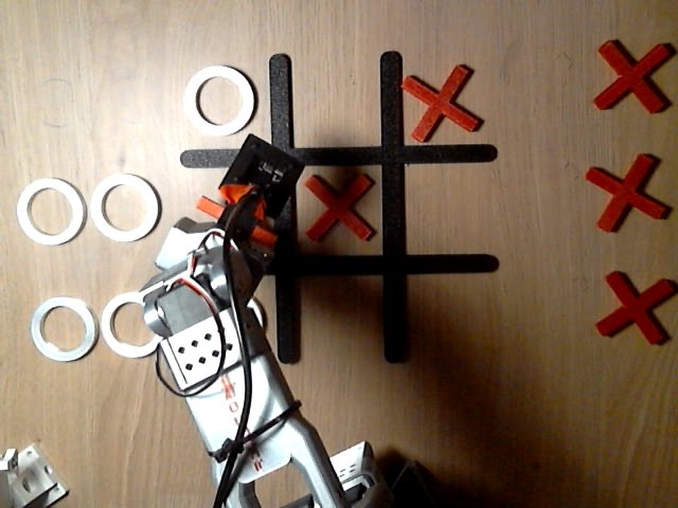
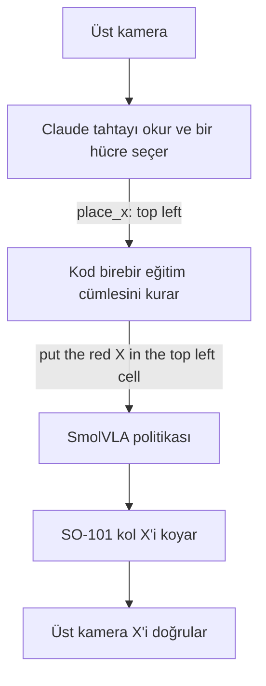
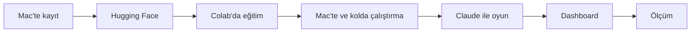
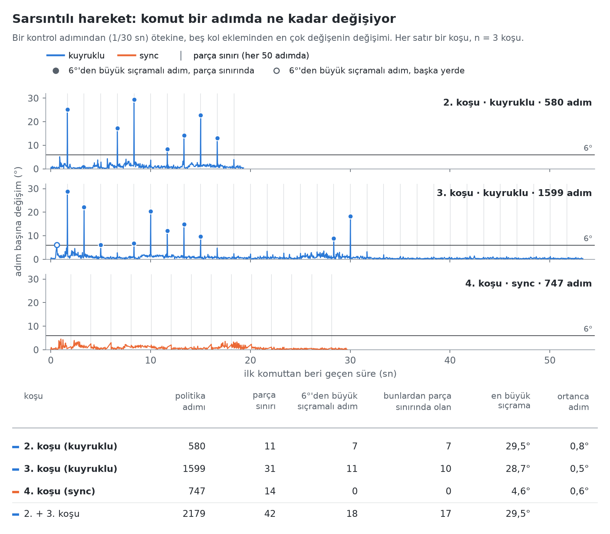

<p align="center"></p>

# SO-101 XOX

[English](README.md) · **Türkçe**

Bir SO-101 robot kolu, O ile oynayan bir insana karşı X ile XOX oynuyor. Claude masanın üstündeki kameradan tahtayı okuyup bir hücre seçiyor, kod bu seçimi politikanın eğitildiği cümlenin birebir aynısına çeviriyor, teleoperasyonla kaydedilmiş 45 gösterimle ince ayar yapılmış bir SmolVLA politikası da kolu oynatıyor. Şimdiye kadar: gerçek kolda tamamlanan on hamle, onu da doğru hücrede; dokuz hücrenin altısı denendi. Bu bir pilot çalışma, bir başarı oranı değil.



*Bir oyunun üçüncü hamlesi, üst kameradan: Claude `middle left` hücresini seçti, kol X'i oraya koyuyor.*

## Bir tur



## Nasıl kuruldu



## Bağlantılar

| | |
|---|---|
| Adım adım anlatım | <https://so101-xox.getporti.com/tr> |
| Blog yazısı | <https://getporti.com/tr/paper/so101-tic-tac-toe> |
| Ayrıntılı yazı | [`docs/tr/writeup.md`](docs/tr/writeup.md) |
| Ölçümler | [`docs/tr/benchmarks.md`](docs/tr/benchmarks.md) |
| Temiz veri seti | [`fport/tic-tac-toe-so101-x-round1-clean-v1`](https://huggingface.co/datasets/fport/tic-tac-toe-so101-x-round1-clean-v1) |
| Ham veri seti | [`fport/tic-tac-toe-so101-x-round1`](https://huggingface.co/datasets/fport/tic-tac-toe-so101-x-round1) |
| Model | [`fport/smolvla-tic-tac-toe-so101-x-round1-20k`](https://huggingface.co/fport/smolvla-tic-tac-toe-so101-x-round1-20k) |



*Ölçümlerden: çıkarım ayarı `sync` yapılana kadar kol sarsılarak hareket ediyordu. Altı grafiğin hepsi [`docs/tr/benchmarks.md`](docs/tr/benchmarks.md) içinde.*

## Hızlı başlangıç

```bash
uv sync                                              # .venv: LeRobot; kayıt, eğitim ve politika için
uv venv .venv-strands --python 3.12 && source .venv-strands/bin/activate
uv pip install "strands-robots[lerobot,smolvla]" "strands-agents[anthropic]"
python scripts/strands_game.py play                  # Claude X, sen O; dashboard'u açar
python scripts/strands_game.py eval --trials 10      # kolda hücre başına değerlendirme, Claude yok
python -m xox.dashboard --demo                       # dashboard tek başına, hazır yazılmış bir oyunla
```

`play` için repo kökündeki `.env` dosyasında `ANTHROPIC_API_KEY` gerekir; `play` ve `eval` için de kol ve iki kamera. Dashboard ve `eval` şimdiye kadar yalnızca sahte kolla denendi. Bayraklar, kolu durdurmak ve geri kalan her şey: [`docs/tr/strands.md`](docs/tr/strands.md).

## Repo düzeni

```
xox/            oyun paketi (python -m xox)
  board.py      hücre adları, görev cümlesi, kazanan
  vision.py     üst kameranın oyuna söyledikleri
  arm.py        robot, politika, hamle başına kayıt
  game.py       Claude ile play döngüsü
  evaluate.py   eval komutu
  cli.py        komutlar ve bayrakları
  i18n.py       İngilizce ve Türkçe terminal mesajları
  state.py      dashboard ile paylaşılan oyun durumu
  dashboard/    yerel web sayfası
scripts/        oyun sarmalayıcısı, kayıt planı, kayıtlı koşu, kare yakalama
notebooks/      Colab eğitim defteri
benchmarks/     grafiklerin arkasındaki betikler ve tablolar
docs/           aşağıdaki belgeler, Türkçeleri docs/tr/ altında
calibration/    iki kolun kalibrasyon dosyaları
assets/         kapak görseli
```

## Belgeler

| | |
|---|---|
| Yazı | [`docs/tr/writeup.md`](docs/tr/writeup.md) |
| Ölçümler | [`docs/tr/benchmarks.md`](docs/tr/benchmarks.md) |
| Kayıt | [`docs/tr/recording.md`](docs/tr/recording.md) |
| Eğitim defteri | [`notebooks/train_smolvla_round1.ipynb`](notebooks/train_smolvla_round1.ipynb) |
| Oyun, Strands ve `eval` | [`docs/tr/strands.md`](docs/tr/strands.md) |
| Kullanım notları | [`docs/tr/operations.md`](docs/tr/operations.md) |
| Yöntem | [`docs/tr/method.md`](docs/tr/method.md) |
| Çalışma günlüğü | [`docs/tr/plan.md`](docs/tr/plan.md) |

## Lisans

Apache License 2.0, bkz. [`LICENSE`](LICENSE). Kod ve koşu kayıtlarının analizi Claude Code ile birlikte yazıldı; yaklaşım, daha önce yapılmış açık bir SO-101 XOX projesini izliyor.
