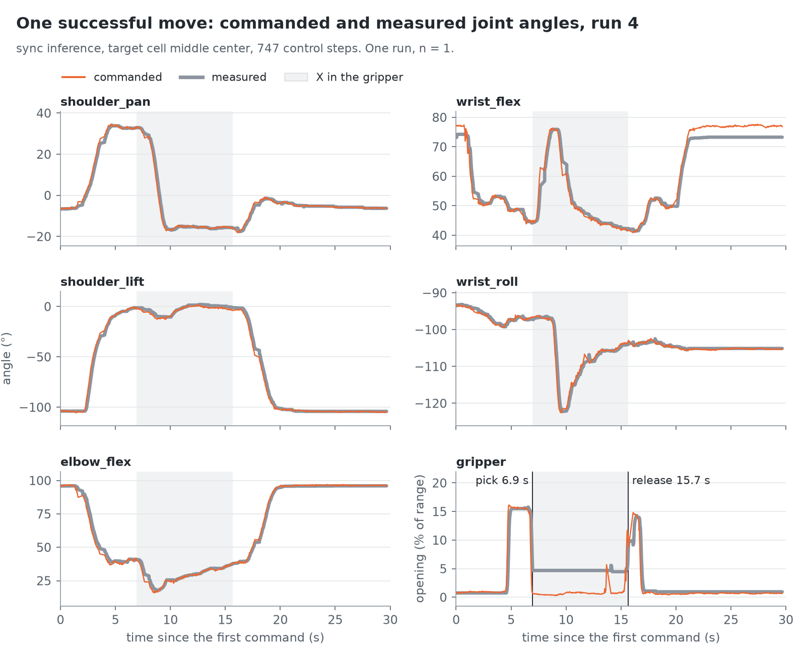
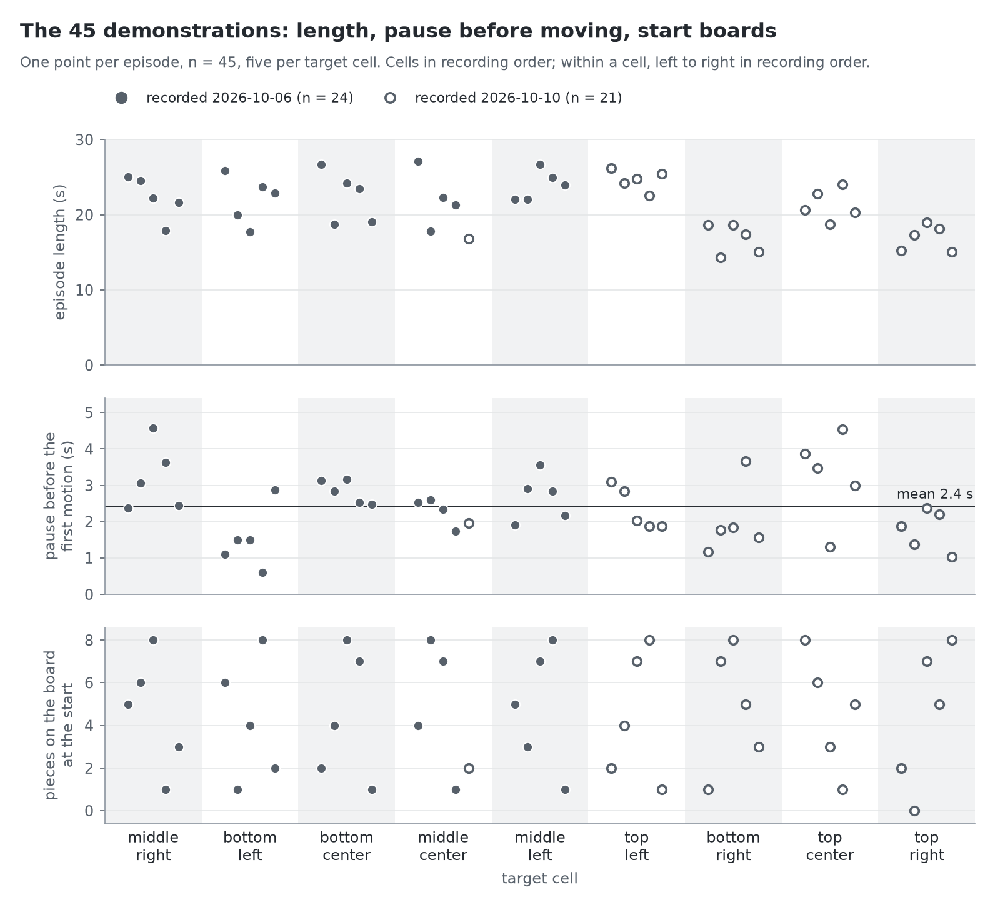
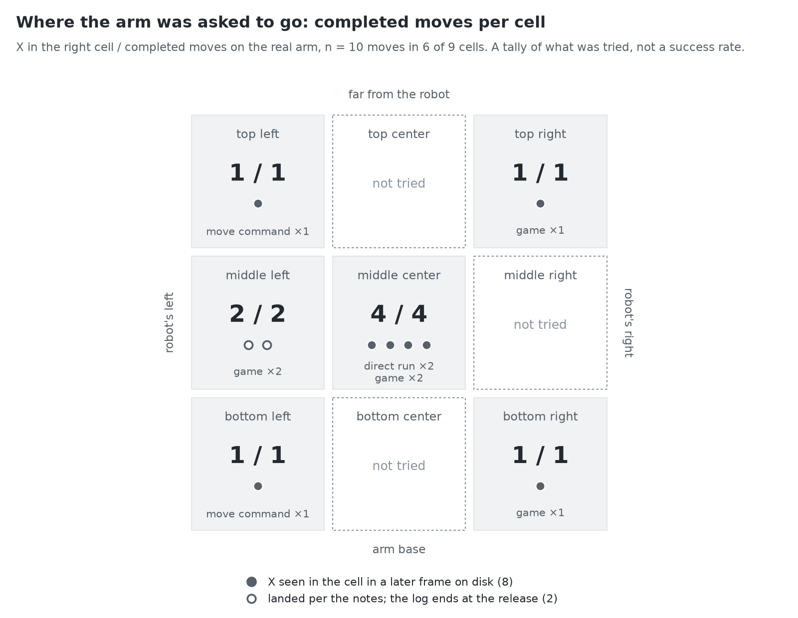
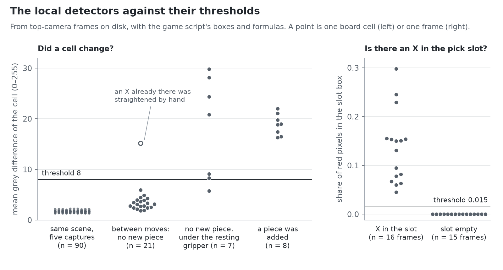

# Measurements

**English** · [Türkçe](tr/benchmarks.md)

Six charts drawn from what was already on disk after the evening of 2026-10-10: the command logs of the arm, the frames saved with them, and the joint data of the 45 demonstrations. No run was made for this page and nothing is compared with a baseline, because none was measured. The story behind the runs is in [`writeup.md`](writeup.md); this page only counts.

The numbers are small: three direct policy runs, ten game-script logs, 45 episodes. Points are shown one by one, nothing is fitted, and no chart is a success rate. Every number on this page is in [`benchmarks/data/key_numbers.csv`](../benchmarks/data/key_numbers.csv), and every definition is a constant in [`benchmarks/extract.py`](../benchmarks/extract.py).

## A. Jerky motion: queued against `sync`


**What it measures.** For every control step, how far the commanded pose moved since the previous step: the largest change among the five arm joints, in degrees. Runs 2 and 3 used the queued inference setting, run 4 used `sync`; all three asked for `middle center`. The grey lines are chunk boundaries, every 50 steps.

**What it shows.** In the two queued runs, 18 steps jump by more than 6°, and 17 of them sit on a chunk boundary (7 of 7 in run 2, 10 of 11 in run 3). The largest is 29.5°, against a median step of 0.8° and 0.5°. Not every boundary jumps: 17 of the 42 do. In run 4 no step exceeds 6° (the largest is 4.6°); instead the arm pauses for 0.4 s at each of its 14 chunk boundaries, which is why its grey lines are farther apart.

**What it does not show.** This is one run per row on one evening, with the `sync` run made last; it is not a controlled comparison and gives no rate at which the queued setting fails. The 6° line is the convention of the write-up, not a property of the arm. The chart shows commands, not motion; how the arm follows a command is in chart B.

## B. One successful move



**What it measures.** Run 4, the first clean move: for each joint the angle the policy commanded and the angle the arm reported, over the 747 steps of the run. The gripper is its opening in percent of its range, not an angle.

**What it shows.** The arm leaves rest at 1.3 s, closes the gripper on the X at 6.9 s, opens it over the cell at 15.7 s, has it closed again at 16.9 s and is back at rest at 19.3 s. While it holds the X the gripper reads 4.7 % open although it is commanded shut; after the release it reads 1.0 %. That difference is how pick and release were read from the log. At rest the command for `wrist_flex` stays 3.8° above the measured angle.

**What it does not show.** One move to one cell. The measured angle is the arm's last reading before each command was sent, so the gap between the two lines is not a tracking error. Where inside the cell the X came to lie is not in the log.

## C. Waiting before the start, and the length of a move


**What it measures.** For 11 logged moves, when the arm starts and when it is back. Time 0 is the first command. The arm has *started* when the commanded pose of any arm joint is more than 10° from the rest pose; if it is pulled back to rest first, the last departure counts. It is *back* by the game script's own rule: the first of 45 consecutive commands with `shoulder_lift` and `elbow_flex` within 8° of rest.

**What it shows.** Run 2 (queued) moved at 1.4 s, was pulled back, started at 6.8 s and was cut off by its 20-second limit at 19.3 s with the X still in the gripper. Run 3 (queued) started at 0.7 s and was back at 29.7 s. The 9 `sync` moves started between 0.2 and 3.2 s (median 1.6 s); the 7 of them whose return is in the log were back between 14.5 and 25.9 s (median 21.5 s). For the third move of each game the log ends 2.3 s and 2.6 s after the gripper was commanded open, with the arm still over the cell, so there is no return time.

**What it does not show.** It is not a comparison of waiting between the two settings: there are two queued moves, and the wait has a second cause in the data (chart D). The times leave out the first inference before the first command: 0.38 to 0.66 s in the game-script logs, not logged in the direct runs. The game script itself reports longer moves, because it ends a move 1.5 s after the arm is back: 23.4 s and 24.0 s for the two `move` runs. Three runs are not in the chart: run 1 was not logged, and in two logs the arm never left rest (the accidental run and the run with an empty pick slot).

## D. The demonstrations



**What it measures.** The 45 episodes of the clean training set, from their joint data; the videos were not read. Top: episode length. Middle: the pause before the first motion, defined as the time of the first frame in which any arm joint of the recorded action (the leader arm, so the operator's hand) is more than 3° from its value in the first frame. Bottom: the number of pieces on the start board, from [`rounds/round1.md`](rounds/round1.md).

**What it shows.** Episodes last from 14.3 to 27.1 s (median 22.0 s). Those recorded on the second day are shorter, with a median of 18.7 s (n = 21) against 22.6 s (n = 24), but not in every cell: `top left`, recorded on the second day, runs from 22.6 to 26.2 s. The pause before the first motion is 2.4 s on average (median 2.4 s, from 0.6 to 4.6 s), and no episode starts within the first half second. In every cell the start boards go from at most 1 piece to all 8 other cells filled.

**What it does not show.** Cell and recording day cannot be separated: each cell was recorded in one block on one day, apart from one re-recorded episode. With the measured state of the follower arm instead of the recorded action, the mean pause is the same 2.4 s and the longest is 4.8 s, but 6 episodes then register motion in the first half second, because the follower is still settling. That the policy learned to wait from these pauses is the write-up's reading; the chart only shows that the pause is in the data.

## E. Where the arm was asked to go



**What it measures.** A tally per cell of the moves that the project notes count as completed on the real arm, and in how many of them the X ended in the right cell.

**What it shows.** 10 moves, 10 in the right cell, over 6 of the 9 cells: `middle center` four times, `middle left` twice, four cells once. `top center`, `middle right` and `bottom center` were never tried. For 8 of the 10 moves the X can be seen in the cell in a later frame on disk. For the other 2, the third move of each game, the log ends at the release, and that the X landed rests on the notes of that evening.

**What it does not show.** This is a tally of what was tried, not a success rate: no cell was tried more than four times, the moves were not planned as trials, and runs that did not complete are left out (run 1, run 2, and the two logs in which the arm never left rest). "In the right cell" was judged by eye, in the automatic game also by Claude reading the board; how well the X is centred was not measured.

## F. The local detectors



**What it measures.** Between calls to Claude the game loop uses two local checks on the top camera frame. Left: the mean grey difference of each of the nine board cells between two frames; the script compares the largest of the nine with the threshold 8. Right: the share of red pixels in the pick-slot box, with the threshold 0.015. Both were recomputed from frames on disk with the script's boxes and formulas.

**What it shows.** Five captures of one unchanged scene give 90 cell differences between 1.3 and 2.2. Between the first frames of consecutive game moves (4 frame pairs; in each an X and an O were added), the 8 cells that received a piece are at 16.3 to 22.0, all above the threshold, and 20 cells where nothing happened are at 1.8 to 5.9. Two things other than a new piece also cross the threshold. The two cells partly covered by the resting gripper, `bottom center` and `bottom right`, are above it in 6 of 7 cases and reach 29.8, because the arm does not come to rest in exactly the same pose. And one cell whose X was straightened by hand between the frames reads 15.2. In the pick slot, 16 frames with an X are at 0.045 to 0.298 and 15 frames with an empty slot are at 0.

**What it does not show.** These frame pairs span a whole arm move. In the game the reference frame is taken after the arm is back, so the gripper effect seen here is not the detector's false-trigger rate in play; that rate has not been measured. The frames are JPEGs from the logs, while the running code sees unencoded frames; 3 JPEG pairs of an unchanged scene reach 2.4 at most. The sample is 4 frame pairs from two games under one light. Several slot frames show nearly the same scene, and none has a hand or the arm over the slot.

## What has not been measured

- **A success rate.** Ten moves on one evening are a tally. The plan calls for ten trials per cell on start boards held out from training; none of that exists yet, and three cells have not been tried at all. A per-cell success rate will come from runs of the `eval` command (`outputs/eval/<time>/results.jsonl`, see [`strands.md`](strands.md)); it has not been run on the arm yet, and it covers the empty board only.
- **A baseline.** No other policy, no earlier checkpoint and no other dataset size was run on the arm. The three inference settings were compared without the arm (the table in the write-up); those numbers are not in the logs on disk and are not redrawn here.
- **Inference time and observation age on the arm.** The logs hold commands and joint angles, not when an observation was taken. The 0.4 s pause of `sync` is visible; the 0.6 to 1 second-old observations of the queued setting are not.
- **Placement accuracy.** Whether the X is in the cell was judged by eye. Its position and rotation inside the cell were not measured.
- **Run 1.** It was not logged.
- **Robustness.** A shifted board, another light, a nearly full board on the arm: not tried. The write-up notes that the board held at most four pieces when the arm moved.
- **Claude's side.** Board reading (16 of 16 in the write-up) and the choice of cell need API calls and were not re-run for this page.
- **The detectors in play.** Their thresholds are shown against frames from two games. How often they trigger wrongly, or miss, during a game has not been counted.

## How to regenerate

Both scripts run in a throwaway environment; nothing is installed into the repo's virtualenvs.

```bash
cd ~/www/so101-xox

# 1. raw logs and dataset -> benchmarks/data/  (needs the git-ignored outputs/ and data/ folders)
uv run --no-project --with matplotlib --with pandas --with pyarrow --with numpy --with pillow \
    python benchmarks/extract.py

# 2. benchmarks/data/ -> docs/assets/benchmarks/  (needs only the committed CSV files)
uv run --no-project --with matplotlib --with pandas --with pyarrow --with numpy --with pillow \
    python benchmarks/make_charts.py
```

Step 1 reads `outputs/rollout_gunluk/`, `outputs/strands_gunluk/`, `outputs/canli/` and `data/tic-tac-toe-so101-x-round1-clean-v1/`; pass `--raw-root PATH` if they live in another checkout. The dataset can be downloaded from the Hub; the logs exist only on the machine that ran the arm, which is why the derived tables are committed. Step 2 writes each chart as PNG and SVG, in English and in Turkish (`<name>.tr.png`). What each table holds and how each quantity is defined: [`benchmarks/data/README.md`](../benchmarks/data/README.md).

The files here were produced with Python 3.13, matplotlib 3.11.2, pandas 3.0.6, numpy 2.5.4 and Pillow 12.3.0. Running both steps twice gives identical files; other library versions may shift a pixel.
