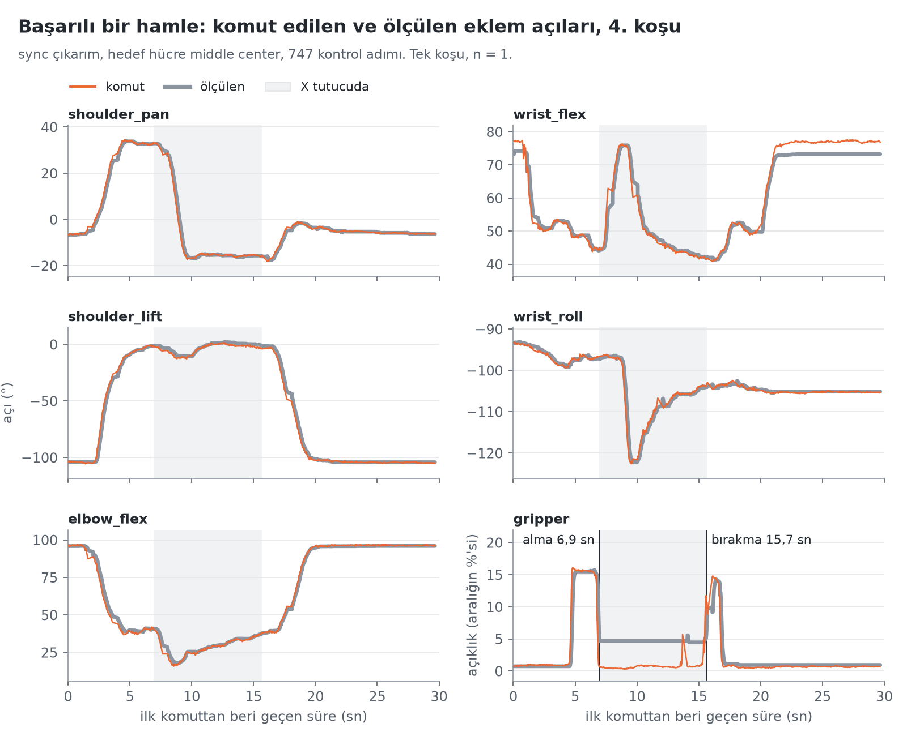
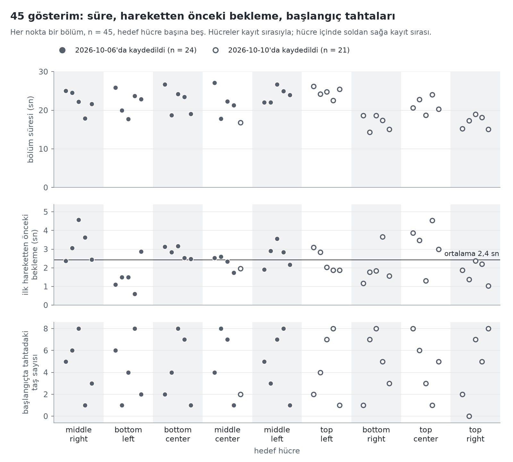
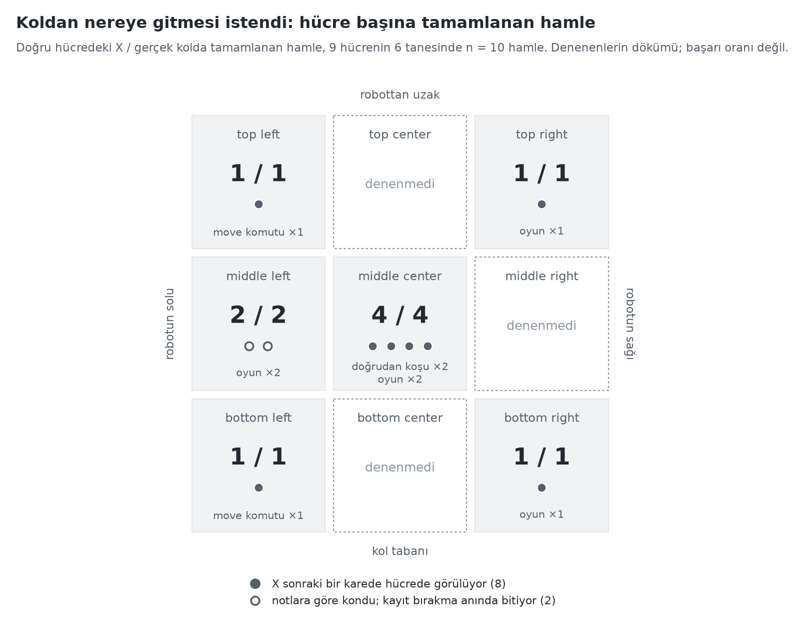
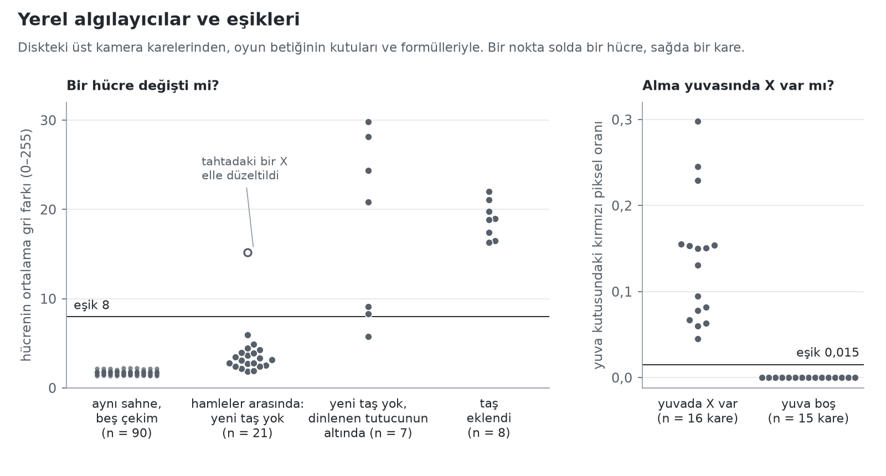

# Ölçümler

[English](../benchmarks.md) · **Türkçe**

2026-10-10 akşamından sonra diskte zaten duran şeylerden çizilmiş altı grafik: kolun komut kayıtları, onlarla birlikte saklanan kareler ve 45 gösterimin eklem verisi. Bu sayfa için yeni bir koşu yapılmadı ve hiçbir şey bir taban çizgisiyle karşılaştırılmıyor, çünkü taban çizgisi ölçülmedi. Koşuların hikâyesi [`writeup.md`](writeup.md) dosyasında; bu sayfa yalnızca sayıyor.

Sayılar küçük: üç doğrudan politika koşusu, on oyun betiği kaydı, 45 bölüm. Noktalar tek tek gösteriliyor, hiçbir şeye eğri uydurulmuyor ve hiçbir grafik bir başarı oranı değil. Bu sayfadaki her sayı [`benchmarks/data/key_numbers.csv`](../../benchmarks/data/key_numbers.csv) dosyasında, her tanım da [`benchmarks/extract.py`](../../benchmarks/extract.py) içinde bir sabit olarak duruyor.

## A. Sarsıntılı hareket: kuyruklu ayar ile `sync`


**Neyi ölçüyor.** Her kontrol adımında komut edilen pozun bir önceki adıma göre ne kadar değiştiğini: beş kol ekleminden en çok değişenin değişimi, derece olarak. 2. ve 3. koşu kuyruklu çıkarım ayarıyla, 4. koşu `sync` ile yapıldı; üçünde de `middle center` istendi. Gri çizgiler parça sınırları, yani her 50 adım.

**Ne gösteriyor.** İki kuyruklu koşuda 18 adım 6°'den fazla sıçrıyor ve bunların 17'si parça sınırında (2. koşuda 7'de 7, 3. koşuda 11'de 10). En büyüğü 29,5°; ortanca adım ise 0,8° ve 0,5°. Her sınırda sıçrama yok: 42 sınırın 17'sinde var. 4. koşuda hiçbir adım 6°'yi geçmiyor (en büyüğü 4,6°); onun yerine kol 14 parça sınırının her birinde 0,4 sn duraklıyor, gri çizgilerin daha seyrek olması bundan.

**Ne göstermiyor.** Her satır tek bir koşu, hepsi aynı akşam ve `sync` koşusu en son yapıldı; bu kontrollü bir karşılaştırma değil ve kuyruklu ayarın ne sıklıkla başarısız olduğunu söylemiyor. 6° çizgisi yazıdaki bir kabul, kolun bir özelliği değil. Grafik hareketi değil komutları gösteriyor; kolun komutu nasıl izlediği B grafiğinde.

## B. Başarılı bir hamle



**Neyi ölçüyor.** 4. koşu, ilk temiz hamle: her eklem için politikanın komut ettiği açı ile kolun bildirdiği açı, koşunun 747 adımı boyunca. Tutucunun değeri açı değil, açıklığının kendi aralığına oranı (yüzde).

**Ne gösteriyor.** Kol 1,3. saniyede dinlenmeden çıkıyor, tutucuyu 6,9. saniyede X'in üstüne kapatıyor, 15,7. saniyede hücrenin üstünde açıyor, 16,9. saniyede yeniden kapatmış oluyor ve 19,3. saniyede dinlenmeye dönüyor. X'i tutarken tutucu, kapalı komutu almasına rağmen %4,7 açık okunuyor; bıraktıktan sonra %1,0. Alma ve bırakma anları kayıttan bu farkla okundu. Dinlenmede `wrist_flex` komutu ölçülen açının 3,8° üstünde kalıyor.

**Ne göstermiyor.** Tek bir hücreye tek bir hamle. Ölçülen açı, kolun her komuttan önceki son okuması; bu yüzden iki çizgi arasındaki fark bir izleme hatası değil. X'in hücrenin içinde tam nereye konduğu kayıtta yok.

## C. Başlamadan önceki bekleme ve bir hamlenin süresi


**Neyi ölçüyor.** Kayıtlı 11 hamlede kolun ne zaman başladığını ve ne zaman döndüğünü. 0 anı ilk komut. Herhangi bir kol ekleminin komut edilen pozu dinlenme pozundan 10°'den fazla ayrıldığında kol *başlamış* sayılıyor; önce dinlenmeye geri çekilirse son ayrılış sayılıyor. *Dönmüş* sayılması oyun betiğinin kendi kuralıyla: `shoulder_lift` ve `elbow_flex` komutlarının dinlenmeye 8°'den yakın olduğu art arda 45 komutun ilki.

**Ne gösteriyor.** 2. koşu (kuyruklu) 1,4. saniyede kıpırdadı, geri çekildi, 6,8. saniyede başladı ve X hâlâ tutucudayken 20 saniyelik sınırı yüzünden 19,3. saniyede kesildi. 3. koşu (kuyruklu) 0,7. saniyede başladı ve 29,7. saniyede döndü. 9 `sync` hamlesi 0,2 ile 3,2 sn arasında başladı (ortanca 1,6 sn); bunlardan dönüşü kayıtta olan 7 tanesi 14,5 ile 25,9 sn arasında döndü (ortanca 21,5 sn). İki oyunun da üçüncü hamlesinde kayıt, tutucuya açılma komutu verildikten 2,3 sn ve 2,6 sn sonra, kol hâlâ hücrenin üstündeyken bitiyor; bu yüzden dönüş süresi yok.

**Ne göstermiyor.** Bu, iki ayarın beklemesini karşılaştırmıyor: kuyruklu yalnızca iki hamle var ve beklemenin veride ikinci bir sebebi daha var (D grafiği). Süreler ilk komuttan önceki ilk çıkarımı içermiyor: oyun betiği kayıtlarında 0,38 ile 0,66 sn, doğrudan koşularda ise kaydedilmemiş. Oyun betiği hamleleri daha uzun bildiriyor, çünkü hamleyi kol döndükten 1,5 sn sonra bitiriyor: iki `move` koşusunda 23,4 sn ve 24,0 sn. Üç koşu grafikte yok: 1. koşu kaydedilmedi, iki kayıtta da kol dinlenmeden hiç çıkmadı (kazara koşu ve alma yuvasının boş olduğu koşu).

## D. Gösterimler



**Neyi ölçüyor.** Temiz eğitim setinin 45 bölümünü, eklem verisinden; videolar okunmadı. Üstte bölüm süresi. Ortada ilk hareketten önceki bekleme; tanımı: kaydedilen eylemde (lider kol, yani operatörün eli) herhangi bir kol ekleminin ilk karedeki değerinden 3°'den fazla ayrıldığı ilk karenin zamanı. Altta başlangıç tahtasındaki taş sayısı, [`rounds/round1.md`](rounds/round1.md) dosyasından.

**Ne gösteriyor.** Bölümler 14,3 ile 27,1 sn arasında sürüyor (ortanca 22,0 sn). İkinci gün kaydedilenler daha kısa: ortanca 18,7 sn (n = 21), ilk günde 22,6 sn (n = 24); ama her hücrede değil: ikinci gün kaydedilen `top left` 22,6 ile 26,2 sn arasında. İlk hareketten önceki bekleme ortalama 2,4 sn (ortanca 2,4 sn, 0,6 ile 4,6 sn arası) ve hiçbir bölüm ilk yarım saniyede harekete geçmiyor. Her hücrede başlangıç tahtaları en çok 1 taşlı bir tahtadan, öteki 8 hücrenin hepsinin dolu olduğu tahtaya kadar gidiyor.

**Ne göstermiyor.** Hücre ile kayıt günü birbirinden ayrılamıyor: yeniden kaydedilen bir bölüm dışında her hücre tek bir blokta, tek bir günde kaydedildi. Kaydedilen eylem yerine takipçi kolun ölçülen durumu kullanılırsa ortalama bekleme yine 2,4 sn, en uzunu 4,8 sn oluyor; ama o zaman 6 bölümde ilk yarım saniyede hareket görünüyor, çünkü takipçi kol hâlâ yerine oturuyor. Politikanın beklemeyi bu duraklamalardan öğrendiği, yazının yorumu; grafik yalnızca beklemenin veride olduğunu gösteriyor.

## E. Koldan nereye gitmesi istendi



**Neyi ölçüyor.** Proje notlarının gerçek kolda tamamlanmış saydığı hamlelerin hücre başına dökümünü ve bunların kaçında X'in doğru hücreye konduğunu.

**Ne gösteriyor.** 10 hamle, 10'u doğru hücrede, 9 hücrenin 6'sında: `middle center` dört kez, `middle left` iki kez, dört hücre birer kez. `top center`, `middle right` ve `bottom center` hiç denenmedi. 10 hamlenin 8'inde X, diskteki daha sonraki bir karede hücrede görülüyor. Kalan 2 hamlede, yani iki oyunun üçüncü hamlelerinde, kayıt bırakma anında bitiyor; X'in konduğu bilgisi o akşamın notlarına dayanıyor.

**Ne göstermiyor.** Bu, denenenlerin dökümü; bir başarı oranı değil: hiçbir hücre dört kereden fazla denenmedi, hamleler deneme olarak planlanmadı ve tamamlanmayan koşular sayılmadı (1. koşu, 2. koşu ve kolun dinlenmeden hiç çıkmadığı iki kayıt). "Doğru hücrede" kararı gözle verildi, otomatik oyunda ayrıca Claude'un tahtayı okumasıyla; X'in hücreye ne kadar ortalı konduğu ölçülmedi.

## F. Yerel algılayıcılar



**Neyi ölçüyor.** Oyun döngüsü Claude'a yapılan çağrıların arasında üst kamera karesi üzerinde iki yerel kontrol kullanıyor. Solda: iki kare arasında dokuz tahta hücresinin her birinin ortalama gri farkı; betik dokuzun en büyüğünü 8 eşiğiyle karşılaştırıyor. Sağda: alma yuvası kutusundaki kırmızı piksel oranı, eşik 0,015. İkisi de diskteki karelerden, betiğin kutuları ve formülleriyle yeniden hesaplandı.

**Ne gösteriyor.** Değişmeyen tek bir sahnenin beş çekimi 1,3 ile 2,2 arasında 90 hücre farkı veriyor. Art arda gelen oyun hamlelerinin ilk kareleri arasında (4 kare çifti; her birinde araya bir X ve bir O eklendi) taş alan 8 hücre 16,3 ile 22,0 arasında, hepsi eşiğin üstünde; hiçbir şeyin olmadığı 20 hücre ise 1,8 ile 5,9 arasında. Yeni taş dışında iki şey daha eşiği aşıyor. Dinlenen tutucunun kısmen örttüğü iki hücre, `bottom center` ve `bottom right`, 7 durumun 6'sında eşiğin üstünde ve 29,8'e kadar çıkıyor, çünkü kol her seferinde tam aynı pozda dinlenmiyor. Bir de iki kare arasında X'i elle düzeltilen bir hücre 15,2 okunuyor. Alma yuvasında, X olan 16 kare 0,045 ile 0,298 arasında, yuvanın boş olduğu 15 kare ise 0'da.

**Ne göstermiyor.** Bu kare çiftleri bütün bir kol hamlesini kapsıyor. Oyunda referans kare kol döndükten sonra alınıyor; dolayısıyla burada görülen tutucu etkisi, algılayıcının oyundaki yanlış tetiklenme oranı değil; o oran ölçülmedi. Kareler kayıtlardaki JPEG'ler, çalışan kod ise sıkıştırılmamış kareleri görüyor; değişmeyen sahnenin 3 JPEG çifti en çok 2,4'e çıkıyor. Örneklem tek bir ışık altında, iki oyundan 4 kare çifti. Yuva karelerinin birkaçı neredeyse aynı sahneyi gösteriyor ve hiçbirinde yuvanın üstünde el ya da kol yok.

## Ölçülmeyenler

- **Bir başarı oranı.** Tek bir akşamdaki on hamle bir dökümdür. Plan, eğitimde görülmemiş başlangıç tahtalarıyla hücre başına on deneme öngörüyor; bunların hiçbiri henüz yok ve üç hücre hiç denenmedi. Hücre başına başarı oranı `eval` komutunun çalışmalarından gelecek (`outputs/eval/<zaman>/results.jsonl`, bkz. [`strands.md`](strands.md)); komut kolda henüz çalıştırılmadı ve yalnızca boş tahtayı kapsıyor.
- **Bir taban çizgisi.** Kolda başka bir politika, daha erken bir kontrol noktası ya da başka bir veri boyutu çalıştırılmadı. Üç çıkarım ayarı kol olmadan karşılaştırıldı (yazıdaki tablo); o sayılar diskteki kayıtlarda yok ve burada yeniden çizilmedi.
- **Kolda çıkarım süresi ve gözlemin yaşı.** Kayıtlarda komutlar ve eklem açıları var, bir gözlemin ne zaman alındığı yok. `sync` ayarının 0,4 sn'lik duraklaması görülüyor; kuyruklu ayarın 0,6 ile 1 saniye önceki gözlemleri görülmüyor.
- **Yerleştirme doğruluğu.** X'in hücrede olup olmadığına gözle karar verildi. Hücrenin içindeki konumu ve dönüklüğü ölçülmedi.
- **1. koşu.** Kaydedilmedi.
- **Dayanıklılık.** Kaymış bir tahta, başka bir ışık, kolda doluya yakın bir tahta: denenmedi. Yazıya göre kol hareket ederken tahtada en çok dört taş vardı.
- **Claude tarafı.** Tahta okuma (yazıda 16'da 16) ve hücre seçimi API çağrısı gerektiriyor; bu sayfa için yeniden çalıştırılmadı.
- **Oyun sırasında algılayıcılar.** Eşikleri iki oyundan karelerle karşılaştırılarak gösteriliyor. Oyun sırasında ne sıklıkla yanlış tetiklendikleri ya da bir değişikliği kaçırdıkları sayılmadı.

## Yeniden üretmek için

İki betik de geçici bir ortamda çalışıyor; reponun sanal ortamlarına hiçbir şey kurulmuyor.

```bash
cd ~/www/so101-xox

# 1. ham kayıtlar ve veri seti -> benchmarks/data/  (git'e girmeyen outputs/ ve data/ klasörlerini ister)
uv run --no-project --with matplotlib --with pandas --with pyarrow --with numpy --with pillow \
    python benchmarks/extract.py

# 2. benchmarks/data/ -> docs/assets/benchmarks/  (yalnızca repodaki CSV dosyalarını ister)
uv run --no-project --with matplotlib --with pandas --with pyarrow --with numpy --with pillow \
    python benchmarks/make_charts.py
```

1. adım `outputs/rollout_gunluk/`, `outputs/strands_gunluk/`, `outputs/canli/` ve `data/tic-tac-toe-so101-x-round1-clean-v1/` klasörlerini okuyor; bunlar başka bir çalışma kopyasındaysa `--raw-root YOL` verin. Veri seti Hub'dan indirilebilir; kayıtlar ise yalnızca kolu çalıştıran makinede duruyor, türetilmiş tabloların repoya konmasının sebebi bu. 2. adım her grafiği PNG ve SVG olarak, İngilizce ve Türkçe (`<ad>.tr.png`) yazıyor. Her tablonun ne tuttuğu ve her büyüklüğün tanımı: [`benchmarks/data/README.md`](../../benchmarks/data/README.md) (İngilizce).

Buradaki dosyalar Python 3.13, matplotlib 3.11.2, pandas 3.0.6, numpy 2.5.4 ve Pillow 12.3.0 ile üretildi. İki adım iki kez çalıştırıldığında birebir aynı dosyalar çıkıyor; başka kütüphane sürümlerinde bir piksel kayabilir.
