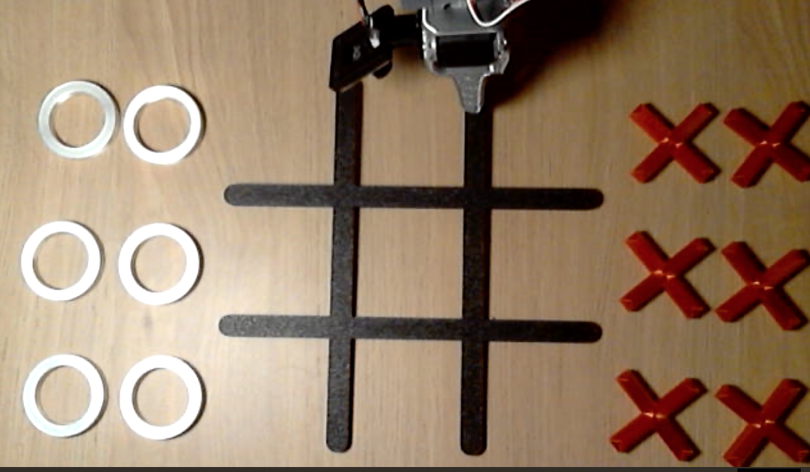

# Plan

[English](../plan.md) · **Türkçe**

Kaynak: `SO-101_XOX_Proje_Plani.pdf` (Ekim 2026). Bu dosya onun kararlaştırılmış hâli; PDF ile çelişirse burası geçerli.



## Kaldığımız yer (2026-10-11)

Adım 0–3 bitti. Neden böyle ilerlediğimiz: [`method.md`](method.md).

- **Tur 1 (pilot) kaydı tamam:** 45 bölüm (#0–#44), 9 görev × 5, artı #45 (aşağıda). HF `fport/tic-tac-toe-so101-x-round1`'de, `v3.0` etiketli.
- 45 bölümün hepsi kontrol edildi: tahtalar [`rounds/round1.md`](rounds/round1.md) ile aynı, X her seferinde doğru hücrede, etiketler doğru, `top`/`wrist` yer değiştirmemiş, hiçbir bölüm 40 sn sınırına takılmamış.
- **#45** çekildi (2026-10-10): #15'in tahtasıyla (X `middle left`, O `bottom left`) yeni `middle center` bölümü, kontrol edildi. Ham repoda 46 bölüm.
- **Temiz set HF'te:** `fport/tic-tac-toe-so101-x-round1-clean-v1` (2026-10-10), ham #15 silindi (son 22 sn'si hareketsizdi), 45 bölüm, 9 × 5, 28 707 kare, `v3.0` etiketli; ham kayıtla bölüm bölüm karşılaştırıldı. Numaralar kayar: ham #16–#45 → temiz #15–#44. Eğitim bu repodan.
- Blok 1–5 2026-10-06'da, Blok 6–9 2026-10-10'da çekildi. Temiz sette ikinci gün çekilen bölümler daha kısa: ortanca 18,7 sn (21 bölüm), ilk günde 22,6 sn (24 bölüm); 45 bölümün hepsinde bölüm süresi 14,3–27,1 sn, ortanca 22,0 sn.
- Dersler: her çağrı için komutu tam hâliyle ver (Blok 5'te #22–#24 geçmişten eski komutla yanlış etiketlendi, `modify_tasks` ile düzeltildi); kayıt sırasında repo adı değiştirme; çağrıları kısa tut (2 + 2 + 1).
- Görünürlük: kullanıcı 2026-10-10'da "public olabilir" dedi; ham ve temiz repo public. 2026-10-11'de GitHub reposu ve model de public yapıldı.
- **Adım 4 hazır (2026-10-10):** Colab defteri [`notebooks/train_smolvla_round1.ipynb`](../../notebooks/train_smolvla_round1.ipynb): `lerobot/smolvla_base`, uzman-only, batch 64, 20k adım, her 5k'da checkpoint Hub'a, model `fport/smolvla-tic-tac-toe-so101-x-round1-20k` (önce private, 2026-10-11'den beri public). Kamera eşlemesi, referans alınan daha önce yapılmış açık bir SO-101 XOX projesindekiyle aynı (`top` → `camera1`, `wrist` → `camera2`, `empty_cameras=1`). Aynı komut Mac'te 3 adımla denendi (MPS, batch 2): dataset, eşleme ve checkpoint kaydı çalışıyor; Colab'da henüz çalıştırılmadı.
- **Adım 4 eğitimi bitti (2026-10-10, 16:36 → ~20:20):** Colab A100 80 GB, 1,49 adım/sn, 20k adım. 100. adımda loss 0,479, sonra 0,077. Son model `fport/smolvla-tic-tac-toe-so101-x-round1-20k` kökünde (önce private, 2026-10-11'den beri public), ara checkpoint'ler `checkpoints/005000` … `020000` altında.
- **Son model Mac'te kol olmadan denendi (2026-10-10):** Hub'dan MPS'e yükleniyor, 50 adımlık parça 0,35 sn. Kayıtlı karelerde tahmin ile kayıttaki hareket arasındaki ortalama fark ~0,4–1° (eğitim verisi; kolda başarıyı göstermez). Aynı karede cümle başka hücreyle değiştirilince tahmin 50°'ye kadar değişiyor (aynı cümlede gürültü ~0,5°): model cümleyi dinliyor. `lerobot-rollout` komutu var olmayan bir portla çalıştırıldı: bayraklar geçerli, politika yükleniyor, porta gelince duruyor.
- **Kolda ilk denemeler (2026-10-10 akşam, `middle center`):**
  - 1. koşu (40 sn): kol dinlenme pozunda kaldı, sadece `wrist_flex` ara ara birkaç derece oynadı.
  - 2. koşu (20 sn, [`scripts/rollout_logged.py`](../../scripts/rollout_logged.py) ile kayıtlı): 6,8 sn bekledi, sonra X'i yuvadan aldı, 18. saniyede `middle center` üstüne getirdi; süre 20 sn'de doldu, bırakamadan geri döndü. Süre kısaydı (benim hatam), 60 sn ile tekrarlanacak.
  - 3. koşu (60 sn, kayıtlı): **ilk tam başarı.** Hemen başladı, X'i ~7. saniyede aldı, ~22. saniyede `middle center` hücresine bıraktı, 30. saniyede dinlenme pozuna döndü.
  - **Sert hareketin sebebi ölçüldü:** `--inference.type=rtc --inference.rtc.enabled=false --inference.queue_threshold=18` ayarında yeni parça, ~0,6–1 sn önceki gözlemden hesaplanıp eski parçanın sonuna ekleniyor; her 50 adımda kol geriye sıçrıyor. İki kuyruklu koşuda (2. ve 3. koşu) 6°'den büyük 18 sıçramanın 17'si tam parça sınırında (yalnızca 3. koşuda 11'in 10'u), en büyüğü 29° (normal adım ~1°). Aynı şey baştaki takılmayı da besliyor: kol harekete başlıyor, eski gözlemden gelen parça onu dinlenme pozuna geri çekiyor (2. koşu, 50. adım: `wrist_flex` 53° → 78°). Bu ayar referans reçeteden ölçmeden alınmıştı.
  - Sahte kolla (sabit görüntü) üç ayar, ilk 7,5 sn: mevcut ayar en büyük sıçrama 31°, duraklama yok; `--inference.type=sync` 6,5°, her 1,7 sn'de 0,4 sn duraklama; RTC açık (`rtc.enabled=true`, `execution_horizon=10`, `queue_threshold=30`) 13°, 0,17 sn. Sırada `sync` kolda denenecek.
  - 4. koşu (`--inference.type=sync`, kayıtlı): **temiz başarı.** 1,3. saniyede başladı, X'i ~16. saniyede `middle center`'a bıraktı, dinlenmeye döndü. Komut sıçraması en çok 4,6° (önce 29°), 6°'den büyük sıfır; her parça sınırında 0,40 sn duraklama (14 kez). Kullanıcı: "tam olması gerektiği gibi". **Bundan sonra varsayılan `sync`.**
  - **Baştaki bekleme:** model dinlenme pozunda "bekle" ile "başla" arasında kararsız. Kayıtlarda harekete geçmeden ortalama 2,4 sn (en çok 4,6 sn) beklenmiş; model bunu öğrenmiş. Aynı karede `wrist_flex` 72° iken her seferinde 57–61° hareket planlıyor, 74° iken (tork açıkken kolun durduğu yer) 17–41°, bazen hiç. Tur 2'de kayıt başlar başlamaz harekete geçilecek; pilot veriden baştaki bekleme kırpılıp yeniden eğitmek de bir seçenek.
  - Kol olmadan teşhis araçları: [`scripts/capture_frames.py`](../../scripts/capture_frames.py) (kameraların şu an gördüğü + eklem açıları, tork açmaz), `scripts/rollout_logged.py` (komut ve durum kaydı).
- **Strands üzerinden kolda iki hamle, ikisi de tuttu (2026-10-10 21:37 ve 21:41):** `scripts/strands_game.py move "top left"` (23 sn) ve `move "bottom left"` (24 sn). X doğru hücrede, kol dinlenmeye dönünce betik hamleyi kendisi bitirdi; komut sıçraması en çok 5,7°. Kolda görülen hücreler: `middle center` (2 kez), `top left`, `bottom left`.
- **Claude tarafı kuru modda denendi:** tam oyun, her turda tek `place_x` çağrısı, engelledi ve kazandı. Anahtar repo kökündeki `.env`'den okunuyor (git'e girmez).
- **Claude ile kolda ilk oyun (2026-10-10 21:49):** Claude `middle center`, `bottom right`, `middle left` oynadı (O'lar `top left`, `bottom left`); üç hamlenin üçü de doğru hücrede (ilk komuttan son komuta 20,8, 16,5 ve 16,7 sn; aynı akşamki otomatik oyunda 27,5, 26,3 ve 18,9 sn, yani iki oyunda yaklaşık 17 ile 28 sn). Oyun yarıda kaldı. Kolda görülen hücreler: `middle center`, `top left`, `bottom left`, `bottom right`, `middle left`.
- **Tahta okuma eklendi:** Enter'a basınca Claude `top` karesinden 9 hücreyi okuyor; 8 gerçek karede 16/16 doğru. 22:10'da canlı tahta okuma çalıştı (5 taş, tam doğru). Ayrıntı [`strands.md`](strands.md).
- **Kolda otomatik oyun (2026-10-10 22:58):** soru yok; kamera alma yuvasına bakıyor, konan X'i doğruluyor ve insanın O'sunu buluyor ([`strands.md`](strands.md)). Claude `middle center`, `top right`, `middle left` oynadı; üçü de doğru hücreye kondu. Oyun bitmeden durduruldu. Kolda şimdiye kadar çalıştığı görülen hücreler: 9'un 6'sı (`middle center`, `top left`, `bottom left`, `bottom right`, `middle left`, `top right`), her deneme isabet (10 hamle: `lerobot-rollout`/`rollout_logged.py` ile sonuna kadar koşan 2, `move` ile 2, oyunlarda 6). On hamlenin sekizinde kolun dinlenmeye dönüşü kayıtta var; kalan ikisinde (iki oyunun da üçüncü hamlesi, ikisi de `middle left`) kayıt, bırakmadan yaklaşık 2,5 sn sonra (tutucuya açılma komutu verildikten 2,3 sn ve 2,6 sn sonra), dönüşten önce bitiyor: oyun orada bitti, X hücreye konmuştu. Henüz denenmeyen: `top center`, `middle right`, `bottom center`.
- **Repo İngilizce varsayılan yapıldı (2026-10-10):** kod İngilizce, belgeler ve terminal mesajları İngilizce ve Türkçe (`--lang tr`, `docs/tr/`).
- **Dashboard eklendi (2026-10-10):** `xox/dashboard`, iki kamerayı, tahtayı, sıranın kimde olduğunu, Claude'un cümlesini, hamle listesini ve durdur düğmesini gösteren yerel web sayfası; `python -m xox.dashboard --demo` kayıtlı kareleri oynatır.
- **Oyun kodu `xox` paketinde, `play` dashboard'u sürüyor (2026-10-11):** oyun `scripts/strands_game.py` dosyasından `xox` paketine taşındı; betik artık ince bir sarmalayıcı, `python -m xox <komut>` aynı program. `play` dashboard'u başlatıp güncel tutuyor ve hamle kayıtlarının yanına `game.jsonl` yazıyor. Oyun sırasında ilk Ctrl+C kolu durduruyor. Bunların hepsi sahte kol, sahte kameralar ve sahte bir Claude ile denendi; gerçek kolda henüz çalıştırılmadı. Kullanım [`strands.md`](strands.md)'de.
- **`eval` komutu eklendi (2026-10-11):** kolda hücre başına değerlendirme; karar üst kameradan, Claude yok: `scripts/strands_game.py eval --trials 10` boş tahtada her hücreyi on kez ister ve `outputs/eval/<zaman>/results.jsonl` dosyasını yazar. Bu, Adım 6'nın boş tahta durumu için araç; eğitimde görülmemiş başlangıç tahtaları hâlâ açık. Yalnızca sahte kol ve montaj karelerle denendi, kolda henüz çalıştırılmadı ([`strands.md`](strands.md)).
- **Sırada:** `eval`'i kolda çalıştırmak; tur 2 verisi (Adım 5: kayıt başlar başlamaz harekete geç); minimax kontrolü.

### Kolda deneme komutu

Önce portlar ve `lerobot-find-cameras` (index 0 = `top`, 1 = `wrist` olmalı). Kol dinlenme pozunda, alma yerinde bir X. `--task` her hücre için değişir. Kayıt tutmak için `lerobot-rollout` yerine `python scripts/rollout_logged.py` (bayraklar aynı). `--rename_map` şart: verilmezse checkpoint'in kendi eşlemesi boş eşlemeyle eziliyor. `max_relative_target` verme.

```bash
cd ~/www/so101-xox && source .venv/bin/activate
lerobot-rollout \
  --strategy.type=base \
  --policy.path=fport/smolvla-tic-tac-toe-so101-x-round1-20k \
  --inference.type=sync \
  --rename_map='{"observation.images.top": "observation.images.camera1", "observation.images.wrist": "observation.images.camera2"}' \
  --robot.type=so101_follower --robot.port=/dev/cu.usbmodem5AB01794851 --robot.id=follower --robot.calibration_dir=calibration \
  --robot.cameras="{ top: {type: opencv, index_or_path: 0, width: 640, height: 480, fps: 30}, wrist: {type: opencv, index_or_path: 1, width: 640, height: 480, fps: 30}}" \
  --task="put the red X in the middle center cell" \
  --duration=60 --display_data=false
```

Süre dolunca ya da Ctrl+C ile durdurunca kol başladığı poza döner, sonra tork kesilir; bu yüzden dinlenme pozundan başlat. Ara checkpoint denemek için `--policy.path=outputs/models/round1-20k/checkpoints/015000/pretrained_model` (15k yerelde duruyor).

## Kararlar

| Konu | Karar | Neden |
|---|---|---|
| Kapsam | Önce sadece X (9 görev), X çalışınca O da (9 görev daha) | Basitten zora. O eklenince X verisi aynen kullanılır, sadece yeni görev cümleleri gelir. |
| Görev cümlesi | `put the red X in the {top\|middle\|bottom} {left\|center\|right} cell` | Her bölüme gömülür, kayıttan sonra değiştirilmez. Harfi harfine bu. |
| Hücre adları | Robotun bakışına göre: `top` = kol tabanından en uzak satır, `left` = robotun solu | Operatör kolun arkasında, robotla aynı yöne bakar. |
| Kameralar | `top` (sabit, tahtaya bakan) + `wrist` | SmolVLA'da `camera1` / `camera2`'ye eşlenir. |
| Alma yeri | Tek alma yuvası; robot hamlesinden sonra sıradaki X'i oraya insan koyar | Pick sabit olunca politika asıl olarak place'i öğrenir, veri ihtiyacı düşer (PDF Faz 0). |
| Bölüm | 40 sn kayıt, 90 sn reset, ikisi de → ile erken biter | Kayıtta ilk hamle ~22 sn sürdü; 25/40 sn yetmedi (2026-10-06). |
| Başlangıç modeli | `lerobot/smolvla_base` | Tahta ve taşlar referans projedekinden farklı, onun checkpoint'i az kazandırır. |
| Dataset | HF, public (2026-10-10'a kadar private planlanmıştı); her tur ayrı ham repo (`fport/tic-tac-toe-so101-x-round1`), temizlenip birleştirilince `-clean-vN` | Referans projenin `tic-tac-toe-so101-<parça>-clean-vN` düzeni. Ham kayıt değişmez. Ayrıntı [`operations.md`](operations.md) "Hugging Face". |
| Kod | GitHub `fport/so101-xox`, 2026-10-11'den beri public (Apache 2.0) | Yazı, veri setleri ve modelle birlikte açıldı. |

## Sahne

Kayıt boyunca hiçbir şey oynamaz. Model sadece eğitimde gördüğü sahneye dayanıklı olur; tahta 3 cm kayarsa ya da kamera açısı değişirse politika hiç görmediği bir durumla karşılaşır (ring-center-v2'de yaşandı: kol dinlenme pozuna yapıştı).

- Bant ızgara, X yuvaları (2×3), O yuvaları (2×3), kol tabanı, `top` kamera: köşeleri bantla işaretli.
- `top` kamera kolun karşısından bakıyor: görüntüde `top` satırı altta, robotun solu sağda görünür.
- Kadrajda hareket eden tek şey follower. Leader ve operatör iki kameranın da dışında.

## Adımlar

- [x] **0 · Repo, ortam, kalibrasyon** (2026-10-05)
- [x] **1 · Donanım kontrolü** (2026-10-05): `top` = index 0, `wrist` = index 1; kol 9 hücreye ve 6 X yuvasına uzanıyor
- [x] **2 · Pilot kayıt planı** (2026-10-05): [`recording.md`](recording.md) protokol ve komut, [`rounds/round1.md`](rounds/round1.md) 9 hücre × 5 = 45 bölüm
- [x] **3 · Pilot kayıt** (tur 1, 2026-10-06 → 2026-10-10): 45 bölüm → HF `fport/tic-tac-toe-so101-x-round1`
- [x] **4 · İlk eğitim:** Colab'da SmolVLA (uzman-only, 20k adım) ve Mac'te kolda ilk denemeler (2026-10-10). Amaç başarı değil, zincirin uçtan uca çalışması.
- [ ] **5 · Dataset'i tamamla:** hücre başına 30–40 bölüm; dolu tahta, ışık varyasyonu, eval için ayrılmış (hold-out) dizilimler
- [ ] **6 · Değerlendirme:** hücre başına 10 deneme, 3×3 başarı haritası. Boş tahta için 2026-10-11'den beri bir araç var, `eval --trials 10`; kolda henüz çalıştırılmadı. Eğitimde görülmemiş başlangıç tahtaları hâlâ açık.
- [ ] **7 · O'lar:** `put the white O in the ... cell`, 9 görev, O için de tek alma yuvası; aynı dataset'e eklenir
- [ ] Sonrası (PDF Faz 2–5): ACT (hedef hücre one-hot), pi0.5, tahta okuma, LLM + minimax oyun katmanı. Kullanıcı 2026-10-10: ilk eğitim bitince oyun katmanını `strands-robots` (PyPI `strands-robots`, `policy_provider="lerobot_local"`) ve Claude API ile deneyeceğiz.

## Neden pilotla başarı beklemiyoruz

SmolVLA tek görev için bile ~50 bölüm istiyor (LeRobot dokümanı: 5 konum × 10; 25 yetmedi). 30 bölümle başarısız olup ACT'nin çalıştığı örnekler var (lerobot issue #1239). 45 bölüm 9 hücreye bölünür; pilot sadece kayıt → Hub → Colab → Mac zincirini doğrular.
