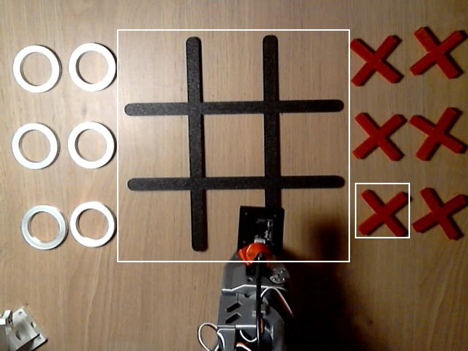
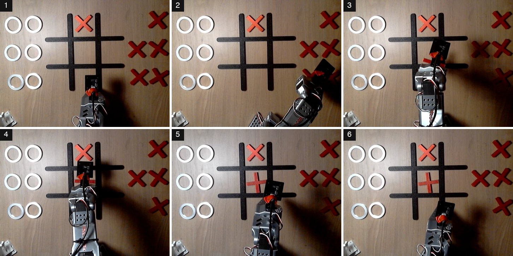
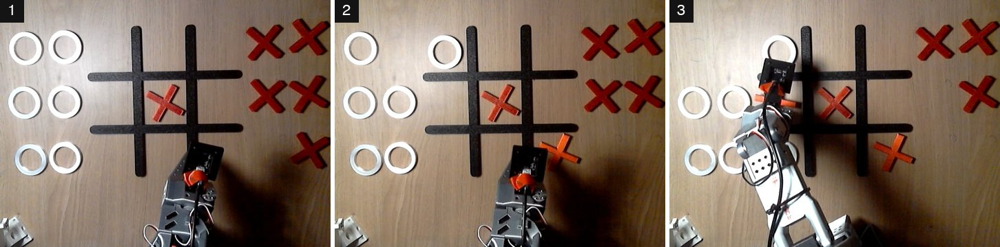
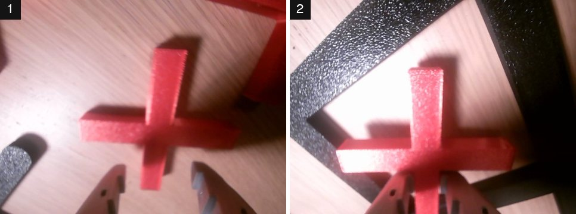
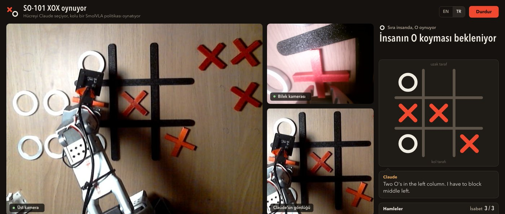
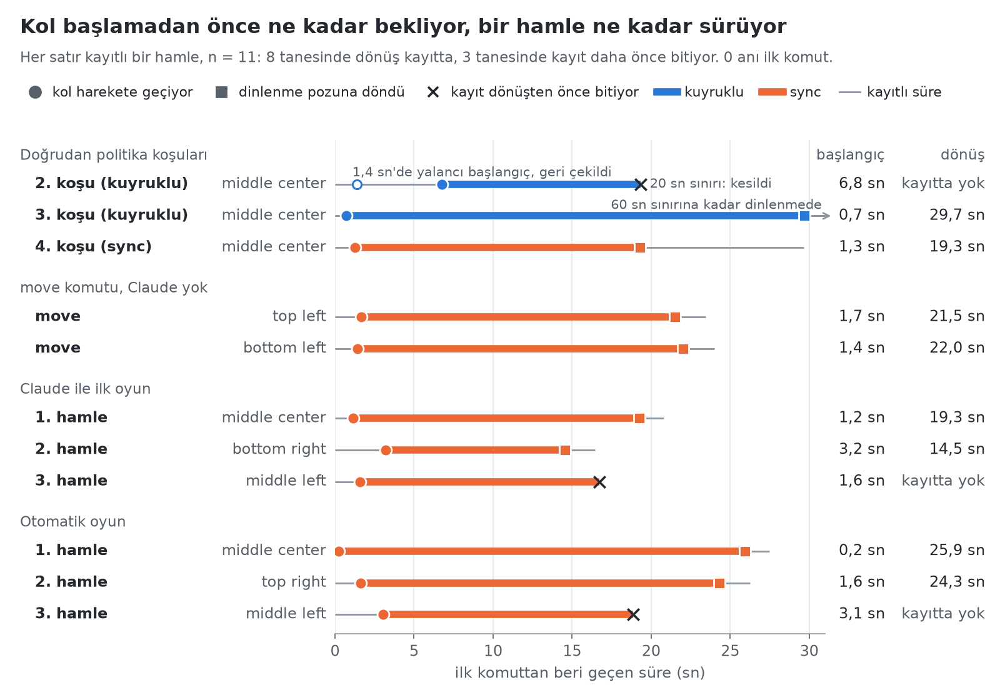

# XOX oynayan bir SO-101 kol: 45 gösterimden sonra ne çalışıyor

[English](../writeup.md) · **Türkçe**


*2026-10-10'daki bir oyunun üçüncü hamlesi, masanın üstündeki kameradan (kol altta kalacak şekilde döndürülmüş). İnsanın O'ları `top left` ve `bottom left` hücrelerinde; Claude `middle left` hücresini seçti, kol X'i oraya koyuyor.*

## Nedir

Bir SO-101 robot kolu, O ile oynayan bir insana karşı X ile XOX oynuyor. Claude masanın üstündeki kameradan tahtaya bakıp bir hücre seçiyor. Kod bu seçimi sabit bir İngilizce cümleye çeviriyor. Elle verdiğim 45 gösterimle ince ayar yapılmış bir sinir ağı olan SmolVLA politikası da bu cümleyi ve iki kamera görüntüsünü motor komutlarına çeviriyor.

Bir tur şöyle geçiyor. Tahtanın yanındaki sabit alma yuvasında kırmızı bir X bekliyor. Claude bir hücre söylüyor. Kol dinlenme pozundan çıkıyor, X'i alıyor, hücreye koyuyor ve dinlenmeye dönüyor; iki oyunda bir hamle yaklaşık 17 ile 28 saniye arasında sürdü. Kamera X'in doğru hücrede olup olmadığına bakıyor, ben yuvaya yeni bir X koyup O'mu yerleştiriyorum, kamera O'yu buluyor. Otomatik modda klavyeye hiçbir şey yazılmıyor.

Tek cümleyle durum: gerçek kolda tamamlanan on hamle, onu da doğru hücrede; dokuz hücrenin altısı denendi, henüz hiçbir oyun sonuna kadar oynanmadı. Bu bir pilot çalışma ve sayılar küçük.

Kaydı ben yaptım, oyunu ben oynadım. Kodu ve koşu kayıtlarının analizini bir yapay zekâ kodlama asistanı olan Claude Code ile birlikte yazdık.

## Nasıl çalışıyor

```
üst kamera ──► Claude ──► place_x("top left")
                               │
                              kod
                               ▼
              "put the red X in the top left cell"
                               │
        üst + bilek kamerası görüntüleri, eklem açıları
                               ▼
                      SmolVLA politikası ──► kol
```

Claude (`claude-opus-5-5`) bir Strands Agents döngüsünün içinde çalışıyor; tahtayı okuyor ve hücreyi seçiyor, kolu hiçbir zaman kendisi sürmüyor. Politika, Strands Robots ve LeRobot üzerinden bir Mac'te çalışıyor. Aradaki kod cümleyi kuruyor, dolu ya da bilinmeyen hücreyi reddediyor, alma yuvasını izliyor ve hamlenin ne zaman bittiğine karar veriyor.

Bu ayrım yeni değil: daha önce yapılmış açık bir SO-101 XOX projesi aynı şekilde kurulmuştu, bu proje de onu referans aldı.

Üç terim. *Politika*, robotun gözlemlediğini bir sonraki hareketine çeviren fonksiyondur. *VLA* (vision-language-action, yani görüntü-dil-eylem modeli), kamera görüntülerini ve bir metin talimatını alıp eylem üreten bir politikadır; SmolVLA bunların küçük bir örneği. Tek tek eylem değil, bir *eylem parçası* (action chunk) üretir: burada sıradaki 50 eklem hedefi, yaklaşık 1,7 saniyelik hareket.

Taklitle eğitilen bir politika kavram öğrenmez. Gördüğü durumda gösterimi yapanı taklit eder, görmediği durumda bocalar. Bu politika eğitimde tam olarak dokuz cümle gördü:

```
put the red X in the {top|middle|bottom} {left|center|right} cell
```

Ona "köşeye koy" demek işe yaramıyor. Bu yüzden Claude'a tek parametreli tek bir araç veriliyor, `place_x(cell)`; cümleyi de kod, eğitim verisindekiyle harfi harfine aynı olacak şekilde yazıyor. Hücre adları robotun tarafından bakılarak verilmiş: `top` kol tabanına en uzak sıra, `left` robotun solu.

## Veri

Gösterimler *teleoperasyon* ile kaydedildi: ikinci bir kolu (leader) elimle oynatıyorum, robot (follower) onu taklit ediyor, LeRobot da eklem açılarını ve iki kamerayı 640×480, saniyede 30 kare olarak kaydediyor.



*Bir oyunun başındaki sahne: O'lar robotun solunda, X'ler sağında, kol dinlenme pozunda. Küçük çerçeve alma yuvası; büyük çerçeve kırpılıp Claude'a gösterilen alan.*

İlk aklıma gelen, her taşın her hücreye gidişini kola birer kez gösterip en sonda eğitmekti. Bu fikir yanlıştı ve kaydı şu düzeltmeler biçimlendirdi:

- **Sahne sabit.** Izgara, taş yuvaları, kol tabanı ve üst kamera bantla işaretli, ışık da hep aynı. Model yalnızca eğitimde gördüğü sahneye dayanıklı.
- **Tek alma yuvası.** X'ler birbirinin aynısı; önemli olan X'in nereden alındığı, hangi hücreye gittiği ve tahtada ne olduğu. Altı yuva 6 × 9 = 54 durum demek, her birine ayrı veri gerekir. Tek yuvayla dokuz durum kalıyor; oyunda yuvayı insan dolduruyor.
- **Gerçek oyundaki gibi tahtalar.** Her gösterim boş tahtada başlarsa kol dolu tahtada taşlara çarpar. Bir betik 45 başlangıç tahtası üretti: hedef hücre başına beş tane, boş tahtadan diğer sekiz hücrenin hepsinin dolu olduğu tahtaya kadar.

Her bölüm tek bir hamle: dinlenme pozundan çıkıp yine oraya dönüş. Beşer bölümlük dokuz bloğun beşi 2026-10-06'da, dördü 2026-10-10'da çekildi.

Sonra 45 bölümün hepsi kontrol edildi: başlangıç tahtası planla aynı, X doğru hücrede, etiket doğru, kameralar yer değiştirmemiş, hiçbir bölüm 40 saniye sınırına takılmamış. Bir bölüm atıldı, çünkü son 22 saniyesi hareketsizdi; aynı tahtayla yeniden çekildi. Temiz sette 45 bölüm ve 28 707 kare var, kabaca 16 dakika; Hugging Face'te `fport/tic-tac-toe-so101-x-round1-clean-v1` adıyla herkese açık.

Bu kadar veri yetmez, bunu baştan biliyordum. LeRobot belgeleri tek bir görev için yaklaşık 50 bölüm öneriyor; burada 45 bölüm dokuz göreve bölünüyor. Pilotun amacı başarı değil, kayıttan Hub'a, Colab'a ve Mac'e uzanan zincirin çalıştığını görmekti.

## Eğitim

Başlangıç modeli `lerobot/smolvla_base`, ayar da LeRobot'un SmolVLA için varsayılan ayarı: yalnızca eylem uzmanı (action expert) eğitiliyor, görüntü-dil modeli dondurulmuş kalıyor. Batch boyutu 64, 20 000 adım. Colab'da bir A100 (80 GB) üzerinde saniyede 1,49 adımla, 2026-10-10 günü 16:36'dan yaklaşık 20:20'ye kadar sürdü. Loss 100. adımda 0,479'du, 0,077'ye indi.

Biten model kola dokunmadan önce Mac'te denendi:

- Mac'in GPU'suna (MPS) yükleniyor ve 50 adımlık bir parçayı 0,35 saniyede hesaplıyor.
- Kayıtlı karelerde tahmini, kayıttaki hareketten ortalama 0,4–1° kadar ayrılıyor. Bunlar eğitim kareleri, yani bu sonuç kolda başarı hakkında bir şey söylemiyor.
- Aynı karede cümle başka bir hücreyle değiştirilince tahmin 50°'ye kadar değişiyor; cümle aynı kaldığında gürültü yaklaşık 0,5°. Model cümleyi dinliyor.

## Kolda ilk koşular

Dört koşunun hepsinde `middle center` istendi.

**1. koşu (40 sn).** Kol dinlenme pozunda kaldı; yalnızca bilek ara ara birkaç derece oynadı. Bu koşu kaydedilmedi; sonrakilerde her komut ve eklem açısı kaydedildi.

**2. koşu (20 sn).** Kol 6,8 saniye bekledi, sonra X'i aldı ve 18. saniyede hücrenin üstüne getirdi. Süre doldu, X'i bırakamadan geri döndü.

**3. koşu (60 sn).** İlk tam başarı: X yaklaşık 7. saniyede alındı, yaklaşık 22. saniyede hücreye bırakıldı, kol 30. saniyede dinlenmeye döndü.

Yani kol işi yapabiliyordu, ama başta takılıyor ve sarsılarak hareket ediyordu. Sebebini kayıtlar gösterdi. Referans projenin reçetesinden burada ölçülmeden alınan çıkarım ayarı, her yeni parçayı 0,6–1 saniye önceki bir gözlemden hesaplayıp eski parçanın sonuna ekliyordu. Kola her 50 adımda geriye sıçraması söyleniyordu. İki kuyruklu koşudaki (2. ve 3. koşu) 6°'den büyük 18 komut sıçramasının 17'si tam parça sınırında (yalnızca 3. koşuda 11'in 10'u); en büyüğü 29°, oysa normal bir adım yaklaşık 1°. Aynı etki baştaki takılmayı da besliyordu: kol harekete başlıyor, eski bir gözlemden gelen parça onu dinlenmeye geri çekiyor (2. koşu, 50. adım: `wrist_flex` 53°'den 78°'ye gidiyor).

Üç ayar kol olmadan, sabit bir görüntüyle, ilk 7,5 saniye üzerinden karşılaştırıldı:

| Çıkarım ayarı | En büyük sıçrama | Duraklama |
|---|---|---|
| Kuyruklu, ilk kullanılan | 31° | yok |
| `sync`: parçayı bitir, sonra yenisini hesapla | 6,5° | her 1,7 sn'de 0,4 sn |
| RTC açık (`execution_horizon=10`, `queue_threshold=30`) | 13° | 0,17 sn |

**4. koşu (`sync`).** Temiz başarı. Kol 1,3. saniyede başladı, X'i yaklaşık 16. saniyede bıraktı ve dinlenmeye döndü. En büyük komut sıçraması 4,6° oldu, 6°'nin üstünde hiç sıçrama yoktu; kol 14 parça sınırının her birinde 0,40 saniye durakladı. O günden beri varsayılan `sync`.


*Her kontrol adımında komut edilen pozun ne kadar değiştiği (beş kol ekleminden en çok değişenin değişimi, derece olarak): 2. ve 3. koşu (kuyruklu) ile 4. koşu (`sync`); gri çizgiler parça sınırları, yani her 50 adım.*



*4. koşu, yaklaşık 0, 6, 9, 14, 18 ve 20. saniyeler: dinlenme, alma, taşıma, yerleştirme, bırakma, dinlenme. `top center` hücresindeki X koşudan önce tahtadaydı.*

Takılmanın ikinci sebebi veride ve düzeltilmiş değil. Kayıtlarda harekete geçmeden önce ortalama 2,4 saniye (en çok 4,6) beklemişim, model de beklemeyi öğrenmiş. Dinlenme pozunda "bekle" ile "başla" arasında kararsız: aynı karede bilek eklemi 72°'deyken her seferinde 57–61°'lik bir hareket planlıyor; 74°'de, yani motorlar açıkken kolun gerçekte durduğu yerde, 17–41° planlıyor, bazen hiç planlamıyor. Bir sonraki turda kayıt başlar başlamaz harekete geçeceğim; pilot veriden baştaki beklemeyi kırpıp yeniden eğitmek de öteki seçenek.

## Oyun katmanı

Oyun üç komutla yürüyor: `scripts/strands_game.py move "top left"` Claude olmadan tek bir hamle oynuyor, `play` bir oyun oynuyor, `board` yalnızca tahtayı okuyor. Dördüncü bir komut, `eval`, kolda hücre başına değerlendirme yapıyor; kararı Claude olmadan üst kamera veriyor ve henüz gerçek kolda çalıştırılmadı. Kod `xox` paketinde, betik de onu çağıran ince bir sarmalayıcı.



*Claude ile ilk oyun, kolun üç hamlesinin her birinin sonuna doğru: `middle center`, `bottom right`, `middle left`.*

**Araç.** Strands Robots'ta serbest metin alan bir robot aracı var; Claude'a o verilmiyor. `place_x(cell)` aynı turda ikinci bir hamleyi de reddediyor. Kol olmadan yapılan kuru çalışmada Claude tam bir oyun oynadı: her turda tek çağrı yaptı, engelledi ve kazandı.

**Tahtayı okumak.** Üst kamera karesi döndürülüyor, ızgaraya kırpılıyor ve Claude'a gösteriliyor; Claude dokuz hücreyi ikinci bir araçla bildiriyor. Gerçek koşulardan sekiz kare (boş tahta, bir ile dört arası taş, biri tutucunun yarı kapattığı bir X) ikişer kez okutuldu: 16 okumanın 16'sı tam doğru, okuma başına 3–8 saniye. Canlı kameradan beş taşlı bir tahta da doğru okundu. Denenmeyen: `bottom center` hücresindeki bir taş; dinlenen tutucu o hücrenin büyük kısmını kapatıyor.

**Otomatik akış.** Kod alma yuvasında kırmızı piksel arıyor, yuva boşsa bekliyor. Omuz ve dirsek 1,5 saniye boyunca başlangıç pozunun 8° yakınında kalınca hamle bitiyor. Ardından Claude tahtayı okuyup X'i doğruluyor. Sonra kod, bir hücre değişip görüntü durulana kadar kareleri yerelde, API çağrısı yapmadan karşılaştırıyor; Claude ancak o zaman yeniden okuyor ve tek yeni O benim hamlem sayılıyor. Eşikler gerçek karelerden geliyor: bir hücrenin ortalama farkı aynı sahnede yaklaşık 2, yeni bir taşta 16–22 (8 hücrede ölçüldü; eşik 8). Hücre adını yazmak yedek yol olarak duruyor.



*Bilek kamerası, politikanın ikinci görüşü: alma yuvasında ve bırakmadan önce hedef hücrenin üstünde.*

**Dashboard.** `play` artık yerel bir web sayfası başlatıyor: iki kamera, tahta, sıranın kimde olduğu, Claude'un cümlesi, hamle listesi ve bir durdurma düğmesi; `python -m xox.dashboard --demo` aynı sayfayı kayıtlı bir yeniden oynatmayla gösteriyor. Buradaki oyunlar terminalden, dashboard `play`'e bağlanmadan önce oynandı; dashboard şimdiye kadar yalnızca sahte kolla ve kayıtlı yeniden oynatmayla çalıştırıldı.



*Dashboard, kayıtlı bir oyunu hazır yazılmış metinle yeniden oynatıyor. Bu canlı bir oyun değil.*

## Şimdiye kadarki sonuçlar

Sonuna kadar koşan her hamlede X doğru hücreye kondu: 10 hamlenin 10'u.

| Nasıl | Hamle | Hücreler |
|---|---|---|
| Doğrudan politika koşuları (3. ve 4. koşu) | 2 | `middle center` iki kez |
| `move`, Claude yok | 2 | `top left`, `bottom left` |
| Claude ile ilk oyun (21:49) | 3 | `middle center`, `bottom right`, `middle left` |
| Otomatik oyun (22:58) | 3 | `middle center`, `top right`, `middle left` |



*Kayıtlı 11 hamlede kolun ne zaman başladığı ve ne zaman dinlenmeye döndüğü; 0 anı ilk komut.*

Bu sayıların arkasındaki ölçümler, grafikler ve tanımlarla birlikte: [`benchmarks.md`](benchmarks.md).

Çekinceler sayıdan daha önemli:

- Dokuz hücrenin altısının çalıştığı görüldü. `top center`, `middle right` ve `bottom center` kolda denenmedi.
- 1. ve 2. koşu yukarıdaki sebeplerle tamamlanmadı.
- İki oyun da sonuna kadar oynanmadı. Kol hareket ederken tahtada en çok dört taş vardı, yani doluya yakın bir tahta denenmedi.
- On hamlenin sekizinde kolun dinlenmeye dönüşü kayıtta var. Kalan ikisinde (iki oyunun da üçüncü hamlesi, ikisi de `middle left`) kayıt, bırakmadan yaklaşık 2,5 sn sonra (tutucuya açılma komutu verildikten 2,3 sn ve 2,6 sn sonra), dönüşten önce bitiyor: oyun orada bitti, X hücreye konmuştu.
- Bunların hepsi tek bir akşamda, verinin kaydedildiği masa düzeninde, son kayıtlardan birkaç saat sonra oldu. Tahtanın, kameranın ya da ışığın kaydığı durum denenmedi.
- On hamle bir başarı oranı değildir. Plan, eğitimde görülmemiş tahta dizilimleriyle hücre başına on deneme öngörüyor.
- Claude'un seçimleri denetlenmiyor. Seçilen hücre için bir minimax kontrolü planlandı, henüz yazılmadı.

## Yolda ters gidenler

- **Yanlış etiketler.** Üç bölüm yanlış cümleyle etiketlendi, çünkü bir kayıt komutu kabuk geçmişinden yeniden kullanılmıştı. Sonradan düzeltildi; o günden beri her kayıt çağrısına komut tam hâliyle veriliyor.
- **Gerçek kolda kazara bir koşu.** Sahte kolla bir test yazılırken, sahte kolu devreye sokan yama tutmadı. Betik varsayılan porttan gerçek kola bağlandı, testin hazır girdisi de onay sorusuna "evet" dedi. Kol 45 saniye boyunca tork altında kaldı ve politika komut gönderdi. Önceki koşudan kalan bir X hâlâ hedef hücredeydi; komutlar dinlenme pozundan en çok 5° ayrıldı ve kol yerinden kalkmadı. O günden beri kol olmadan yapılan her test var olmayan bir portla çalıştırılıyor.

## Sırada ne var

- Gerçek kolda dashboard ile oynamak: dashboard artık `play` komutuna bağlı, ama şimdiye kadar yalnızca sahte kolla ve kayıtlı yeniden oynatmayla çalıştırıldı. Minimax kontrolünü eklemek.
- Tur 2 verisi: hücre başına 30–40 bölüm, dolu tahtalar, ışık çeşitlemesi, değerlendirme için ayrılmış dizilimler; bölüm başında bekleme yok.
- Değerlendirme: `eval` komutunu kolda çalıştırmak, hücre başına on deneme, boş tahta için 3×3'lük bir başarı haritası; eğitimde görülmemiş başlangıç tahtaları ondan sonra.
- O taşları: dokuz yeni cümle (`put the white O in the ... cell`) ve onlara ait ayrı bir alma yuvası.
