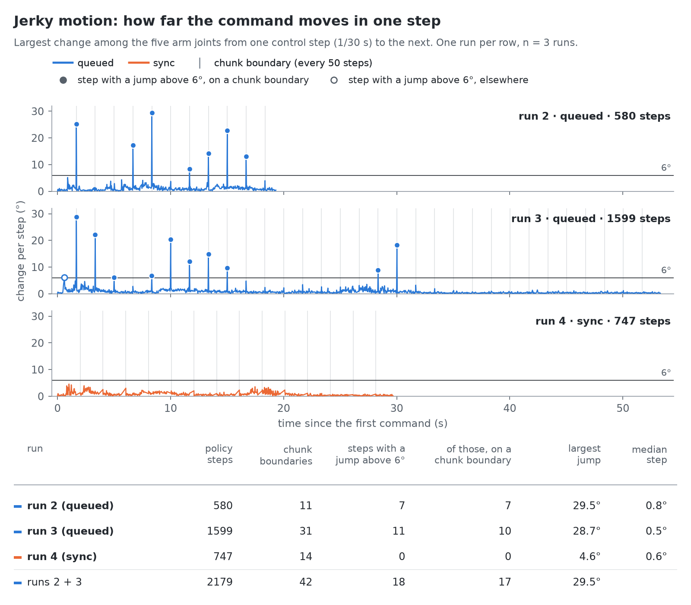
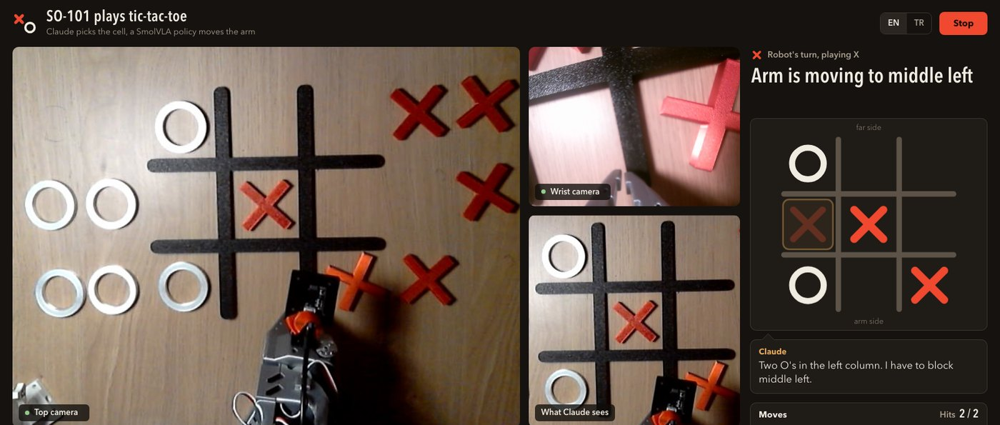
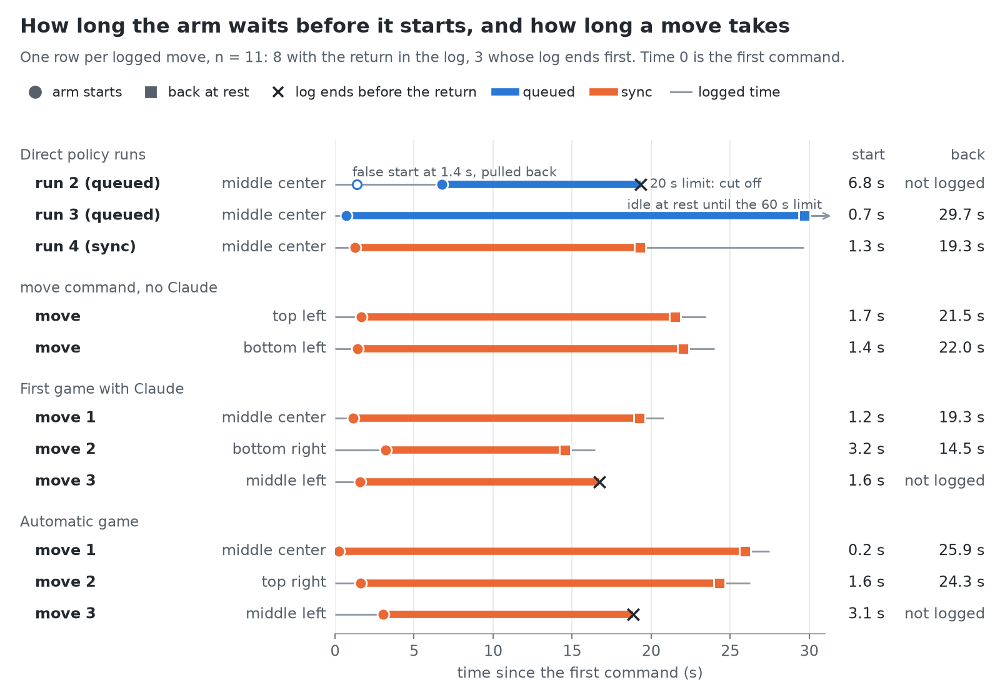

# An SO-101 arm that plays tic-tac-toe: what works after 45 demonstrations

**English** · [Türkçe](tr/writeup.md)


*The third move of a game on 2026-10-10, seen by the camera above the table (rotated so that the arm is at the bottom). The human has O in `top left` and `bottom left`; Claude picked `middle left`, and the arm is putting the X there.*

## What it is

An SO-101 robot arm plays tic-tac-toe ("XOX" in Turkish) as X against a person who plays O. Claude looks at the board through a camera above the table and picks a cell. Code turns that pick into one fixed English sentence. A SmolVLA policy, a neural network fine-tuned on 45 demonstrations I gave by hand, turns that sentence and two camera images into motor commands.

A turn looks like this. A red X waits in a fixed pick slot next to the board. Claude names a cell. The arm leaves its rest pose, picks the X, puts it in the cell and comes back to rest; over the two games a move took about 17 to 28 seconds. The camera checks that the X is in the right cell, I put a new X in the slot and place my O, and the camera finds the O. In the automatic mode nothing is typed.

The state in one line: ten completed moves on the real arm, all ten in the right cell, six of the nine cells tried, no game played to the end yet. This is a pilot and the numbers are small.

I did the recording and the playing. The code and the log analysis were written with Claude Code, an AI coding assistant.

## How it works

```
top camera ──► Claude ──► place_x("top left")
                               │
                             code
                               ▼
              "put the red X in the top left cell"
                               │
          top + wrist camera images, joint angles
                               ▼
                        SmolVLA policy ──► arm
```

Claude (`claude-opus-5-5`) runs inside a Strands Agents loop; it reads the board and picks the cell, and it never drives the arm. The policy runs through Strands Robots and LeRobot on a Mac. The code in between builds the sentence, refuses a taken or unknown cell, watches the pick slot and decides when a move is over.

The split is not new: an earlier open SO-101 tic-tac-toe project was built the same way, and this project used it as a reference.

Three terms. A *policy* is the function that maps what a robot observes to what it does next. A *VLA* (vision-language-action model) is a policy that takes camera images and a text instruction and outputs actions; SmolVLA is a small one. It outputs an *action chunk* rather than one action at a time: here the next 50 joint targets, about 1.7 seconds of motion.

A policy trained by imitation does not learn concepts. In a situation it has seen, it imitates the demonstrator; in one it has not seen, it flounders. This one saw exactly nine sentences in training:

```
put the red X in the {top|middle|bottom} {left|center|right} cell
```

Telling it "put it in the corner" does not work. So Claude gets one tool with one argument, `place_x(cell)`, and the code writes the sentence, letter for letter as in the training data. Cell names are from the robot's side: `top` is the row farthest from the arm's base, `left` is the robot's left.

## The data

The demonstrations were recorded by *teleoperation*: I move a second arm (the leader) by hand, the robot (the follower) copies it, and LeRobot records the joint angles and both cameras at 640×480, 30 frames per second.


*The scene at the start of a game: O pieces on the robot's left, X pieces on its right, the arm in its rest pose. The small outline is the pick slot; the large one is the area that is cropped and shown to Claude.*

My first idea was to show the arm each piece going to each cell once and to train at the end. It was wrong in ways that shaped the recording:

- **The scene is fixed.** The grid, the piece slots, the arm base and the top camera are marked with tape, and the light stays the same. The model is only robust to the scene it saw in training.
- **One pick slot.** The X pieces are identical; what matters is where the X is picked from, which cell it goes to and what is on the board. Six slots would make 6 × 9 = 54 situations, each needing its own data. With one slot there are nine, and a human refills it during a game.
- **Boards as in a real game.** If every demonstration starts from an empty board, the arm hits the pieces on a full one. A script generated 45 start boards, five per target cell, from an empty board to one with all eight other cells filled.

Each episode is one move, from the rest pose and back to it. Five of the nine blocks of five were recorded on 2026-10-06 and four on 2026-10-10.

All 45 episodes were then checked: the start board matches the plan, the X is in the right cell, the label is correct, the cameras are not swapped, no episode hit the 40-second limit. One was thrown away because its last 22 seconds were motionless; it was recorded again on the same board. The clean set has 45 episodes and 28,707 frames, roughly 16 minutes, and is public on Hugging Face as `fport/tic-tac-toe-so101-x-round1-clean-v1`.

This is not enough data, and I knew that going in. LeRobot's documentation suggests about 50 episodes for a single task; here 45 are split over nine. The pilot was meant to prove the chain from recording to the Hub to Colab to the Mac, not to succeed.

## Training

The starting point was `lerobot/smolvla_base`, with LeRobot's default setting for SmolVLA: only the action expert is trained and the vision-language model stays frozen. Batch size 64, 20,000 steps. On a Colab A100 (80 GB) it ran at 1.49 steps per second, from 16:36 to about 20:20 on 2026-10-10. The loss was 0.479 at step 100 and came down to 0.077.

The finished model was checked on the Mac before it touched the arm:

- It loads onto the Mac's GPU (MPS) and computes a 50-step chunk in 0.35 seconds.
- On recorded frames its prediction differs from the recorded motion by about 0.4–1° on average. These are training frames, so this says nothing about success on the arm.
- On the same frame, swapping the sentence for another cell changes the prediction by up to 50°, against about 0.5° of noise with the sentence unchanged. The model listens to the sentence.

## First runs on the arm

All four runs asked for `middle center`.

**Run 1 (40 s).** The arm stayed in its rest pose; only the wrist moved a few degrees now and then. This run was not logged; the next ones recorded every command and joint angle.

**Run 2 (20 s).** The arm waited 6.8 seconds, then picked the X and had it over the cell at second 18. The time ran out and it went back without releasing.

**Run 3 (60 s).** First full success: X picked at about second 7, released in the cell at about second 22, back at rest at second 30.

So the arm could do the job, but it stalled at the start and moved in jerks. The logs showed why. The inference setting, copied from the reference project's recipe without being measured here, computed each new chunk from an observation 0.6–1 second old and appended it to the end of the old chunk. Every 50 steps the arm was told to jump backwards. Of the command jumps larger than 6° in the two queued runs (runs 2 and 3), 17 of 18 sit exactly on a chunk boundary (10 of 11 in run 3 alone); the largest is 29°, where a normal step is about 1°. The same effect fed the stalling: the arm begins to move, and a chunk from a stale observation pulls it back to rest (run 2, step 50: `wrist_flex` goes from 53° to 78°).

Three settings were compared without the arm, on a fixed image, over the first 7.5 seconds:

| Inference setting | Largest jump | Pause |
|---|---|---|
| Queued, as first used | 31° | none |
| `sync`: finish the chunk, then compute the next | 6.5° | 0.4 s every 1.7 s |
| RTC on (`execution_horizon=10`, `queue_threshold=30`) | 13° | 0.17 s |

**Run 4 (`sync`).** Clean success. The arm started at second 1.3, released the X at about second 16 and returned to rest. The largest command jump was 4.6°, none was above 6°, and the arm paused for 0.40 seconds at each of the 14 chunk boundaries. `sync` has been the default since.



*How far the commanded pose moved at every control step (the largest change among the five arm joints, in degrees) in runs 2 and 3 (queued) and run 4 (`sync`); the grey lines are chunk boundaries, every 50 steps.*


*Run 4 at about 0, 6, 9, 14, 18 and 20 seconds: rest, pick, carry, place, release, rest. The X in `top center` was on the board before the run.*

The second cause of the stalling is in the data and is not fixed. In the recordings I waited 2.4 seconds on average (4.6 at most) before moving, and the model learned to wait. At rest it is undecided between "wait" and "start": on the same frame, with the wrist joint at 72° it plans a motion of 57–61° every time; at 74°, where the arm actually sits with its motors on, it plans 17–41°, and sometimes none. In the next round I will start moving the moment recording starts; trimming the wait from the pilot data and retraining is the other option.

## The game layer

Three commands cover the game: `scripts/strands_game.py move "top left"` plays one move without Claude, `play` plays a game, and `board` only reads the board. A fourth command, `eval`, runs a per-cell benchmark on the arm, judged by the top camera without Claude; it has not been run on the real arm yet. The code is in the `xox` package and the script is a thin wrapper around it.


*The first game with Claude, near the end of each of the arm's three moves: `middle center`, `bottom right`, `middle left`.*

**The tool.** Strands Robots has a robot tool that takes free text; Claude does not get it. `place_x(cell)` also refuses a second move in the same turn. In a dry run without the arm, Claude played a full game with one call per turn, blocked, and won.

**Reading the board.** The top frame is rotated, cropped to the grid and shown to Claude, which reports the nine cells through a second tool. Eight frames from real runs (an empty board, one to four pieces, one X half covered by the gripper) were each read twice: 16 of 16 fully correct, 3–8 seconds per read. A live board with five pieces was also read correctly. Not tested: a piece in `bottom center`, which the resting gripper mostly covers.

**The automatic flow.** The code checks the pick slot for red pixels and waits if it is empty. The move ends when the shoulder and elbow are back within 8° of the start pose for 1.5 seconds. Claude then reads the board to verify the X. After that the code compares frames locally, with no API call, until a cell has changed and the image is still; only then does Claude read again, and the single new O is taken as my move. The thresholds come from real frames: a cell's mean difference is about 2 for an unchanged scene and 16–22 with a new piece (8 cells measured; threshold 8). Typing the cell name remains as a fallback.


*The wrist camera, the policy's second view: at the pick slot, and above the target cell before release.*

**The dashboard.** `play` now starts a local web page with both cameras, the board, whose turn it is, Claude's sentence, the move list and a stop button; `python -m xox.dashboard --demo` shows the same page with a recorded replay. The games here were played from the terminal, before the dashboard was wired into `play`; so far it has only been run with a fake arm and with the recorded replay.



*The dashboard replaying a recorded game with scripted text. This is not a live game.*

## Results so far

Every move that ran to its end put the X in the right cell: 10 of 10.

| How | Moves | Cells |
|---|---|---|
| Direct policy runs (runs 3 and 4) | 2 | `middle center` twice |
| `move`, no Claude | 2 | `top left`, `bottom left` |
| First game with Claude (21:49) | 3 | `middle center`, `bottom right`, `middle left` |
| Automatic game (22:58) | 3 | `middle center`, `top right`, `middle left` |



*For 11 logged moves, when the arm starts and when it is back at rest; time 0 is the first command.*

The measurements behind these numbers, with charts and definitions: [`benchmarks.md`](benchmarks.md).

The caveats matter more than the count:

- Six of nine cells have been seen working. `top center`, `middle right` and `bottom center` have not been tried on the arm.
- Runs 1 and 2 did not complete, for the reasons above.
- Neither game was played to the end. The board held at most four pieces when the arm moved, so a nearly full board has not been tried.
- For eight of the ten moves the arm's return to rest is in the log. In the other two (the third move of each game, both `middle left`) the log ends about 2.5 s after the release (2.3 s and 2.6 s after the gripper was commanded open), before the return: the game ended there, with the X already in the cell.
- All of this happened on one evening, on the table setup the data was recorded on, hours after the last recordings. A shifted board, camera or light has not been tested.
- Ten moves are not a success rate. The plan calls for ten trials per cell on board layouts held out from training.
- Claude's choices are not checked. A minimax check on the picked cell is planned and not written.

## What went wrong along the way

- **Wrong labels.** Three episodes were labelled with the wrong sentence because a recording command was reused from the shell history. They were fixed afterwards; since then every recording call is given its command in full.
- **An accidental run on the real arm.** While a test with a fake arm was being written, the patch that swapped in the fake did not take. The script connected to the real arm on its default port, and the test's canned input answered "yes" to the confirmation prompt. The arm stayed powered for 45 seconds with the policy sending commands. An X from the previous run was still in the target cell, and the commands stayed within 5° of the rest pose; the arm did not leave its place. Since then every test without the arm is run with a port that does not exist.

## What is next

- Play on the real arm with the dashboard: it is wired into `play` now, but has so far only been run with a fake arm and with the recorded replay. Add the minimax check.
- Round 2 of data: 30–40 episodes per cell, full boards, light variation, layouts held out for evaluation, and no waiting at the start of an episode.
- Evaluation: run `eval` on the arm, ten trials per cell, for a 3×3 success map of the empty board; start boards held out from training come after that.
- The O pieces: nine more sentences (`put the white O in the ... cell`) with a pick slot of their own.
